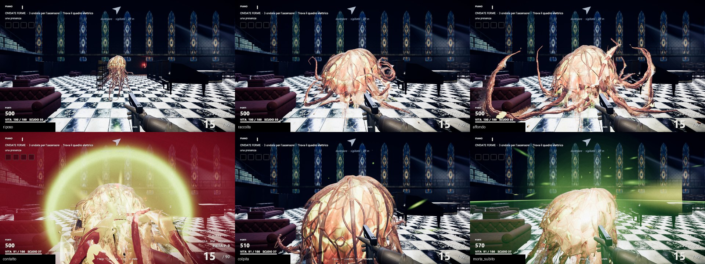

# The Medusa

The flying jellyfish of the Tower, rebuilt on 17 November 2026 from a reference picture: a giant translucent bell with the flesh
and the rips of a corpse, a green light burning inside it, a ring of long fangs and dozens of porous tentacles that drip. The old
one (a procedural sphere with cyan tentacles, built in `AlienRig.cs`) is gone. The new one is a real model made by a Blender
script, animated by code, with its own attack effects. Hit points, speed, damage and timings did not change, so every system that
knows the Medusa (floors from 2 up, the waves, co-op, the stealth alert) works as before.

This page covers the model, the textures, the animation, the effects of the attack, how to make it all again and what is checked.
The enemy itself (flight, windup, contact) is described with the other flying presences in [tower.md](tower.md).



## What it is

| | |
| --- | --- |
| Type | `Enemy.EnemyType.Medusa`, a flying alien (`EnemyTemi.IsAlien`), base archetype `Occhio` for its death branch |
| Numbers | 140 hit points, speed 1.9, melee damage 15 to 19, 2.6 s between attacks (`AlienRig.SetAlienStats`, `Enemy.FlyingMelee`) |
| Attack | windup 0.55 s, contact at 0.71 s, back to normal at 1.13 s (`FlightWindup`, `FlightContact`, `FlightDuration`) |
| Weak point | the mouth: a child collider `Bocca` tagged `Head`, so the usual head multiplier applies |
| Blood | acid green (`Enemy.BloodTint`): the droplets, the mist and the stain on the wall behind it |
| Prefab | `Resources/Medusa.prefab`, made by `Editor/MedusaImport.cs`, loaded by `Enemy.BuildMedusa` |

## The model

66,646 triangles and 240 bones in one skinned FBX (`Models/Medusa/medusa.fbx`), one mesh per material, all weighted on the same
skeleton. The bell is about 1.1 m across. Geometry, bones and weights come from `modelli/medusa/genera_medusa.py`
(Blender 4.5, headless, no add-ons); the geometry helpers are in `modelli/medusa/medusa_lib.py`.

| Mesh | What it is | Material |
| --- | --- | --- |
| `m_gel` | The bell: a lobed dome with holes and rips whose edges are fleshy lips, a torn and frilled rim, one dented flank. | `Medusa_GelDietro` and `Medusa_Gel`: two materials on one submesh, the back faces first, then the front faces |
| `m_cappa` | A veil of lace laid over the bell. | `Medusa_Cappa` |
| `m_interno` | The inside of the bell, where the green light burns. | `Medusa_Interno` |
| `m_carne` | Twelve ribs and twelve thinner veins on the bell, the neck, the lips, six oral arms (0.6 to 1.05 m), sixteen tentacles (1.15 to 1.9 m, seven or eight segments each, with swellings and helical filaments) and five bundles of three thin threads. | `Medusa_Carne` |
| `m_velo` | Lace ribbons wound round the arms and most tentacles, fourteen lace drapes hanging from the rim (0.3 to 0.7 m), and the tiny threads and drops at the tips and at the fangs. | `Medusa_Velo` |
| `m_denti` | The ring of fangs round the mouth. | `Medusa_Denti` |
| `m_luce` | The glowing organs inside the bell (five lobes, a ring channel, a central bulb), an ember at the bottom of the throat, and the luminous nodules strung along the tentacles. | `Medusa_Luce` |

Bones: `radice`, `corpo`, `campana_{0..7}_{0..2}` (eight sectors of the bell, three bones each along the meridian), `collo_0/1`,
`bocca`, `fronte`, `labbro_i_k` (the petals of the mouth), `braccio_i_k` (six oral arms), `tent_j_k` (sixteen tentacles),
`drappo_k_0/1` (the fourteen drapes) and `filo_g_k` (the five thread bundles). A mesh and a bone never share a name (the
importer would merge them).

### Textures and materials

Twenty-four PNG files in `Textures/Medusa`, drawn by `modelli/medusa/genera_medusa_tex.py` (Python and numpy only, about 40 s,
about 16 MB): base colour, a normal map and a mask for every material (R metallic, G occlusion, A smoothness), plus an emission
map for the gel, the inside and the organs. The bell, the veil and the inside use a disc UV (the centre of the dome is the centre
of the texture), so the holes, the ribs and the organs are drawn once in texture space; `holes.json`, written by the Blender
build, tells the texture script where they are.

The bell is a premultiplied-alpha URP material (`_Blend = 1`, ZWrite off) drawn twice, back faces at queue 3000 and front faces
at 3001, so that the inside of the bell shows through its own skin. The veil is at 3002 and the frills at 3003, both double
sided. Translucent parts cast no shadow. The emission is added at full strength, which is what makes the organs read through
the gel from every side.

## How it moves

There are no clips: `Scripts/Jelly/JellyRig.cs` moves the bones every frame, in world space, from the bone positions alone (it
does not depend on the FBX axes). `Enemy.Tick` and the co-op puppet code feed it with `Drive(phase, speed, hunting, striking,
flightTime)`.

- **The pulse.** The bell beats 0.5 to 1 time a second (faster when hunting and when moving): each of the eight sectors is three
  bones rotated about its tangent axis, with a small lag from sector to sector, a fast power stroke (the first 26 % of the cycle)
  and a slow release. The body bobs with the beat and leans forward more when it hunts. The direction of each rotation is probed
  numerically at start-up, so it does not depend on how the FBX was exported.
- **The mouth.** The twelve lip petals (two bones each) open with a slow wander, wider when hunting, on the gather, on the strike
  and when hit; the mouth bone wags a little.
- **Ropes.** Tentacles, oral arms, drapes and threads are Verlet ropes: the first point is pinned to its bone, the segment lengths
  are kept, and a spring pulls the rope towards a desired shape (rest pose, two out-of-phase sways, the gather and thrust
  shapes). The spring is stiff at the root and loose at the tip, so they trail behind the body and whip when it stops or turns.
  A tentacle that would go under the floor is lifted (one ray per tentacle about every 0.25 s).
- **Hit.** `Hit(point)` makes the bell shudder (a faster beat and a spasm), opens the mouth, flashes the organs and kicks every
  rope away from the shot.
- **Death.** `Die()` goes limp: the bell sags half closed, the mouth hangs open, the ropes lose their stiffness and fall under
  heavy gravity, the organs go out, and the body falls like the Occhio. At the moment of death the glow is capped and stays green
  (no yellow-white charge), so the spasm of the last hit does not turn the inside of the bell white; then it fades out.
- **Glow.** The organs, the inside and the gel share one emission level, written with a material property block (no material
  instances): green-acid at rest, yellow-white when charging. It is higher when the Medusa is alert (`glowBoost`) and drives the
  point light `LuceOrgani`.
- **Ambient effects.** Within 24 m of the camera tentacle tips shed drops and the bell lets luminous spores rise.
- **Cost.** Far away it steps less often (every second frame beyond 24 m, every fourth beyond 40 m, from
  `Enemy.LastViewDistance`); the rig then catches up with one longer step.

### The attack

The windup, the thrust and the recovery follow `Enemy.FlightElapsed`, so the host and the co-op replicas animate the same way:

| Time | What the body does | What the effects do |
| --- | --- | --- |
| 0 to 0.55 s: gather | The bell flares open, the body leans back and trembles, the mouth opens, tentacles and arms curl up and back, and the organs rise to several times their resting glow, turning from green to yellow-white. | Glowing motes are sucked into the mouth from all around, a halo grows at the mouth and saliva drips from the fangs (`JellyFx.Gather`). |
| 0.55 to 0.71 s: thrust | The bell contracts hard (the power stroke), the body pitches 64 degrees forward, the mouth opens wide, and every rope gets one lash impulse and then reaches forward. | A jet of 26 mucus drops, 12 sparks and four clouds leaves the mouth, with a halo and a green light (`JellyFx.Lunge`). |
| 0.71 s: contact | Nothing more: the damage is dealt by the enemy (`Enemy.Melee.cs`). | If the target is hit: an umbrella of 40 stretched droplets, 16 sparks, five clouds of toxic fog, a flash, an expanding ring (`ShockRing`), a stain on the wall or the floor behind the target and a green light (`JellyFx.Contact`). |
| 0.71 to 1.13 s: recover | The thrust fades out, the bell relaxes, the tentacles fall back and the glow decays. | |

A miss makes the jet but no contact. The contact effects use the game's standard puff and spark materials, which the flying-melee
test counts as an impact, so every other effect of the Medusa (the gather, the jet, the hit, the death, the drops and the spores)
uses copies with their own names (`Fx_PuffMuco`, `Fx_SparkMuco`); `Fx.Particle` takes an optional material for this.

Other effects: a hit from the player throws a few luminous drops (`JellyFx.Hit`); the death bursts into 46 drops, 26 sparks, fog,
a low ring and a green flash placed in front of the bell, towards the camera (`JellyFx.Death`). Everything goes through the pooled
quads of `Fx` (no particle system).

### In co-op

The host decides the attack. A client replays it: the puppet has the same `JellyRig` and gets the same `Drive` calls, hit
kicks (`Enemy.Net.cs`) and alert glow, and plays the contact effect only when the host reports a hit. No new protocol field.

## Making it again

```powershell
# 1. geometry, skeleton, weights, materials -> modelli/medusa/medusa.blend and holes.json
blender -b -P modelli/medusa/genera_medusa.py -- build
# previews (Cycles; MEDUSA_SAMPLES=32 for a quick one): riferimento lato sotto tre_quarti contratta intero bocca
blender -b -P modelli/medusa/genera_medusa.py -- render lato tre_quarti
# FBX for Unity -> modelli/medusa/export/medusa.fbx
blender -b -P modelli/medusa/genera_medusa.py -- export
# 2. the 24 textures straight into the Unity folder (--solo gel,cappa for some; --anteprima sheet.png for a contact sheet)
python modelli/medusa/genera_medusa_tex.py
# 3. copy the FBX over unity/PryingEyes/Assets/_PryingEyes/Models/Medusa/medusa.fbx, then rebuild materials and prefab
#    (RunAndShot also saves two views of six poses to TestPaths.Out)
Unity.exe -batchmode -projectPath unity/PryingEyes -executeMethod PryingEyes.EditorTools.MedusaImport.Run -quit
```

`.blend` files, previews, the export folder and `holes.json` are derived and ignored by git; the FBX and the textures in
`unity/PryingEyes/Assets/_PryingEyes` are what the game uses.

## Where the code is

| Piece | File |
| --- | --- |
| Model, skeleton, weights | `modelli/medusa/genera_medusa.py`, `medusa_lib.py` |
| Textures | `modelli/medusa/genera_medusa_tex.py` |
| Import, materials, prefab, pose photos | `Editor/MedusaImport.cs` |
| Animation | `Scripts/Jelly/JellyRig.cs` |
| Effects | `Scripts/Jelly/JellyFx.cs` (also `ShockRing`) |
| Test | `Scripts/Jelly/JellyTest.cs` |
| Hooks in the enemy | `Enemy.cs` (`BuildMedusa`, `Drive`, `Hit`, `Die`), `Enemy.Melee.cs` (`Contact`), `Enemy.Budget.cs` (`LastViewDistance`), `Coop/Enemy.Net.cs`, `Stealth/Enemy.Stealth.cs` |

## Verification

`PryingEyes.exe -batchmode -autotest -nofire -noenemies -jellytest [-jellyshots] -seed 1000 -floor 1` (`Scripts/Jelly/JellyTest.cs`):
the prefab and its skeleton (eight bell sectors, lips, at least forty ropes, the mouth collider), the pulse of the rim, tentacles
that sway and follow, no rope under the floor and no number gone wild, the cost of one animation step, the gather (organs light
up, motes, tentacles curl up), the thrust (mouth and ropes go forward), the contact (damage, particles in view, ring, flash), the
recovery, a hit (organs flash, drops), the death (burst, ring, organs out) and the co-op replica (gather, a miss without impact,
a hit with one). With `-jellyshots` the photos go to `unity_logs/jelly/`.

Last run (17 November 2026, a full build of the branch after the merge with `preview`): `-jellytest` 32/32 in about 25 s, one
animation step 0.13 to 0.14 ms, and `-flyingmeleetest` 117/117. The photos of the six main moments (rest, gather, thrust, contact,
hit, burst) are the contact sheet at the top of this page, made from the pictures that `-jellyshots` writes to `unity_logs/jelly/`.

Not verified: co-op between real processes (only the replica inside one process is tested), several Medusas at once and the cost
of the 24 m and 40 m throttling in a real wave, and the look on the other themes (the photos are all of the cathedral hall).

`-flyingmeleetest` keeps checking the Medusa with the Occhio and the Veglia: a miss must produce no impact particle within 20 m of
the camera (the check ignores the ambient sparks of far lamps and cables, which it used to count and which made it fail for every
flying type).

## Traps

- A mesh and a bone must not share a name, and the FBX is exported with `axis_forward='-Z'`, `axis_up='Y'`, no leaf bones and no
  baked animation.
- `GetInstanceID()` is obsolete in this Unity (6000.6): per-instance offsets use `Random.Range`.
- The edit-mode photos of the importer switch the effects off (`JellyFx.Enabled = false`): `Fx` lives in a `DontDestroyOnLoad`
  object that does not exist outside play mode.
- Automatic mesh LODs would shorten the index buffers of the bell and the lace: `generateMeshLods` is off in the importer.
- A new kind of particle for the Medusa must not use `Fx.PuffMat` or `Fx.SparkMat` unless it is a real impact (see above).
- In `-batchmode` the game runs thousands of frames a second: the test waits in game time (`WaitForSeconds`, `Time.time`), never in
  frames. A photo lengthens one frame, so the test caps `Time.maximumDeltaTime` at 0.05 s, or the 0.71 s of the attack would jump
  in one step. The attack time is read from `JellyRig.FlightTime`.
- The emission of the bell is added in full over the translucent gel and then passes through the bloom: `JellyRig.Glow` keeps it
  low and capped, or the bell turns into a white block on the gather and the thrust.
- A flash light must not sit on the bell, inside it or against the camera: the first photos of the death and of the contact burnt
  the gel and the tentacles to white. The death flash stands 1.4 to 2.6 m in front of the bell, towards the camera, and the contact
  flash 0.5 m behind the point of contact.
- The player's torch (`Fascio`) burns the pale gel and the inside of the bell to white at about a metre. It stutters while the
  Medusa is alive and close (stealth danger) and shines steady once it is dead, so the first photo of the death was a white ball
  with no effect of ours behind it. The test switches the beam off for the photos of the death only; everything else is lit as in
  the game.
