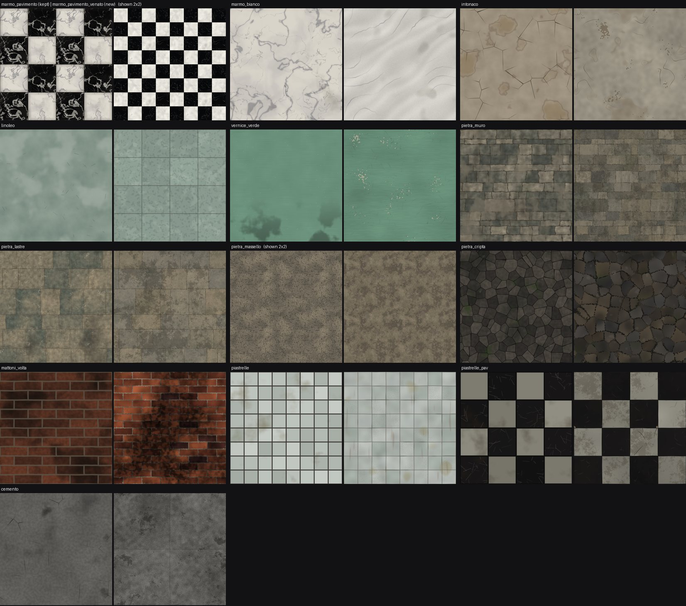
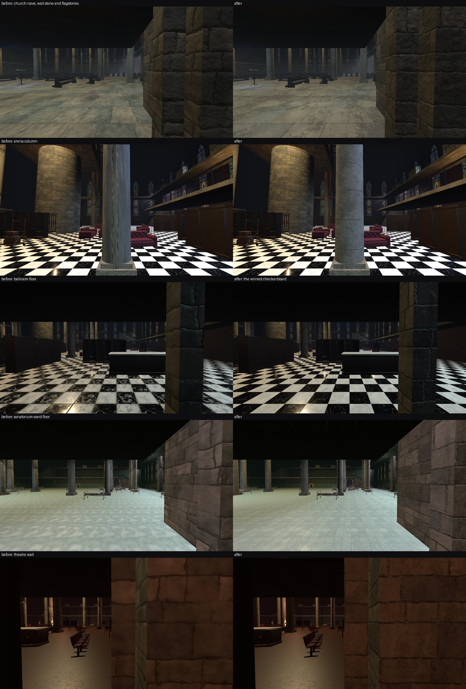

# Wall, column and floor textures

Redone on 17 November 2026. The textures of the walls, columns and floors that looked badly made were regenerated, and the stone
columns of the arenas were rebuilt so that a texture finally fits them. The checkerboard marble floor now comes in two versions that
alternate from room to room. The textures are all procedural (numpy and Pillow, no photographs, nothing downloaded) and they all repeat
without a seam.



*Left of each pair: the texture that was in the game before. Right: the one that replaces it. In the first pair the left image is the
classic checkerboard floor, which stays in the game, and the right one is the veined checkerboard that now alternates with it.*

## What changed

What was wrong, in the old generators: stains and clouds were blurred blobs; cracks were the borders of a Voronoi diagram (a
net of straight polygons); marble veins were closed rings of one noise field; joints were flat; the green paint had a damp gradient that
jumped every 2 m; the columns used a Unity cylinder whose texture coordinates run 0 to 1 once, so a 4 m wall texture was smeared over a
shaft that is 3 m high.

| Texture set (`Textures/Hotel/`) | Where it is used | What it is now |
| --- | --- | --- |
| `marmo_pavimento` | Classic checkerboard floor, kit key `pav_marmo` (material `Floor`, 1.2 m per repetition, 2 x 2 tiles of 60 cm) | **Unchanged**, byte for byte. It stays and alternates with the veined one. |
| `marmo_pavimento_venato` (new) | Veined checkerboard floor, kit key `pav_marmo_venato`, 2.4 m per repetition | 4 x 4 tiles of 60 cm, each cut from its own stone: white Carrara (soft grey bands, a few thin veins) and black Marquina (a network of fractures healed with white calcite). Tight joints with a little grime, polish worn dull in patches, fine scratches. |
| `marmo_bianco` | Stairs, desk and furniture marble (`Marble`), now 2 m per repetition (it was 1 m) | A slab of Carrara: bands with crisp veins along them. |
| `intonaco` | Plaster of walls and ceilings | Hand-applied mottling, sand grain, an irregular water stain with a partial rim, hairline cracks that branch, ragged patches where the paint flaked. |
| `linoleo` | Sanatorium floors | 25 cm tiles of speckled vinyl, each with its tone, grimy seams, heel scuffs, a sheen that is smoother along the walking lanes. |
| `vernice_verde` | Sanatorium wall paint | Semi-gloss oil paint with brush marks, scuffs and chips down to the undercoat. No height gradient, so it repeats. |
| `pietra_muro` | Church and catacomb walls, 4.2 m per repetition | Dressed limestone courses: every block has its own tone (wide enough between blocks that the courses read from across a room), a gently domed face with a few pits and mineral flecks; rounded and chipped arrises; 26 mm recessed lime mortar; a few paler replaced blocks; rain runs, soot and damp. |
| `pietra_lastre` | Church flagstones, 4.8 m | Courses of slabs worn smooth at the centre, hairline cracks that wander, dirt and damp packed in the joints. |
| `pietra_massello` | Capitals, cornices, statue stone, 1.5 m | Carved limestone without joints: fine pores, flecks, weathered patches with ragged edges. |
| `pietra_colonna` (new) | Shaft of the arena columns, 2.4 m | Three drums of 80 cm, each one a single stone that goes all the way round, so the texture wraps with no vertical seam. |
| `pietra_cripta` | Crypt walls and floor | Rubble: rounded fieldstones of different sizes in wide dark mortar, moss in the hollows, white salts. |
| `mattoni_volta` | Brick vaults, 1.6 m, 6 x 16 bricks | Bricks with their own hue and sandy surface, a few almost black; candle smoke that blackens the joints and the rough faces. |
| `piastrelle` | Wall tiles of kitchens and operating rooms | Glazed 15 cm tiles: orange-peel glaze, pinholes, fine crazing, chipped corners, grease and rust drips. |
| `piastrelle_pav` | Black and dirty-white floor tiles | 30 cm stoneware, speckled, scuffed, with a cracked tile and chipped corners. |
| `cemento` | Service floors | Four 1 m slabs between saw cuts, each with its own tone, aggregate, air holes, hairline cracks and oil and water stains. |

Not touched: `parquet`, `moquette`, `quercia_portale`, `noce`, `damasco`, `acciaio` and the others.

## The two checkerboards alternate

`FloorBuilder.MarbleFloor(room)` chooses the marble floor of a room: the classic one (`pav_marmo`) when `(room.id + room.variant)` is
even, the veined one (`pav_marmo_venato`) when it is odd. Both have 60 cm tiles: the classic texture repeats every 1.2 m with 2 x 2 of them,
the veined one every 2.4 m with 4 x 4. `variant` is a random number of the plan, so
the two floors mix from room to room and from seed to seed; the choice depends on the room alone, so the sites built inside another room
(`StyleOf(site.host)`) agree with it. The rooms with a marble floor are the atrium, rotunda and winter garden, the ballroom, the theatre
foyer and the changing room of the Guardaroba. A kit that does not have `pav_marmo_venato` (an old saved scene) gives the classic floor.

## The columns

`RoomKits.Column` (the stone columns of the round arenas) used Unity primitives: a cylinder and four cubes. A primitive has one 0 to 1 square
of texture coordinates per face, and the material repeats every 4.2 m, so the shaft showed a 4 m piece of wall stretched over the whole
height. It is now one mesh: the shaft takes the texture of `pietra_colonna` once around and its height in metres (joints every
80 cm, starting at the floor), and the four blocks of the base and the capital use box projection in metres. The kit material is
`colonna_pietra` (`TorreBuilder.FillKit`, 2.4 m per repetition). The collider, the footprint and the names (`Colonna`) are as before.

## How the textures are made

`modelli/hotel/texlib.py` is a small toolkit with no engine and no game names; `genera_texture.py` and `genera_texture_chiesa.py` use it.

- `gauss_field`: periodic Gaussian random fields with a chosen band of frequencies and slope; the natural mottling, grain and stains, and the
  level lines of such a field have the shape of real cracks.
- `contour`: thin lines along the zero level of a field, with a constant width in pixels (a threshold gives fat blobs where the field is flat).
- `normals_mm`, `write_set`: the height is in millimetres and the size of a pixel is known, so relief means the same at any resolution.
- In `genera_texture_chiesa.py`: `block_shift` (every block reads the same field from a place of its own, so stones are cut from different
  rock), `stain` (a field cut at the level that covers a given fraction, with a soft edge: it has detail at every scale, unlike a blurred blob),
  `cavity` (darkening in the hollows, taken from the height map) and `_rubble` (a weighted Voronoi diagram for the rounded stones).

Marble veins are the zero levels of a sine stripe family bent by slow turbulence. `VEIN_K` (veins per tile) and `VEIN_TURB` (how far a
vein wanders) in `genera_texture.py` matter: with many stripes the tile looks like a fingerprint, with too much turbulence the stripes
close into rings like the contour lines of a map. The values in the file (0.8 to 1.7 veins, 0.2) are the ones that look like marble.

**The light was tuned on the old textures.** Every new base map has the mean luminance (of its sRGB values) of the one it replaces, so the
rooms change in detail and not in brightness. Eight stone, brick, tile and concrete sets, `marmo_bianco` and `linoleo` are scaled to the
old value with `match_luminance`: `pietra_muro` 0.370, `pietra_lastre` 0.426, `pietra_massello` 0.400, `pietra_cripta` 0.203,
`mattoni_volta` 0.196, `piastrelle` 0.662, `piastrelle_pav` 0.268, `cemento` 0.351, `marmo_bianco` 0.783, `linoleo` 0.575. The veined floor
is scaled to the classic floor's 0.455. `intonaco` (0.552 before, 0.555 now) and `vernice_verde` (0.513, 0.507) land within 0.006 without
being scaled. The new `pietra_colonna` is 0.380, between the wall stone and the flagstones.

## Making them again

```powershell
python -I modelli/hotel/genera_texture.py <folder> [--solo marmo_scacchiera_venato,marmo_bianco,intonaco,linoleo,vernice_verde] [--anteprima sheet.png]
python -I modelli/hotel/genera_texture_chiesa.py <folder> [--solo pietra_muro,pietra_lastre,pietra_massello,pietra_colonna,pietra_cripta,mattoni_volta,piastrelle,piastrelle_pav,cemento]
```

Without a folder the files go to `unity/PryingEyes/Assets/_PryingEyes/Textures/Hotel`. Generate into a temporary folder and copy what you want
(never write into the Assets folder while an editor has the project open). A set is `<name>_base.png`, `_normal.png` and `_mask.png`
(R metallic, G occlusion, A smoothness). The generators are deterministic. Commit the PNGs and their `.meta` files. Without `--solo` the
first script also remakes the classic checkerboard `marmo_pavimento`, which comes out identical to the committed one (checked by comparing
the files).

The editor imports new textures by itself (`HotelBuilder.ImportHotelTextures`, which `TorreBuilder.FillKit` calls) and every
`ProcShots` or build run rebuilds the kit materials.

## Checking

- The photos: the same three seeds as the performance probe, at floor 3, with the real look, before and after:

  ```powershell
  Unity -batchmode -projectPath unity\PryingEyes -executeMethod PryingEyes.EditorTools.ProcShots.Run -quit -seed 2995 -floor 3 -look -survivallayout -tag alb
  ```

  (2995 hotel and church, 2961 theatre, 3046 sanatorium). `-colshot -only colonna` makes one close-up of an arena column: the first
  column in creation order, seen from the first side nothing blocks, so the same seed gives the same shot before and after a change.
  The "before" photos are the same commands on the commit before this change.



*Left: before. Right: after. In the column pair the camera is the same; the old shaft shows a 4 m piece of wall stone stretched
over its height, with a vertical seam.*

- Mean luminance of each new base map against the old one (table above).
- Seams: the wrap-around edge of every map against the two pairs of pixels next to it (about 1.0 when it is as continuous as its surroundings).
  The highest value over the 42 new maps is 1.7 (the normal map of the veined floor and the linoleum, whose joints lie on the edge itself),
  the median 1.00. A white marble that was not periodic along one axis (ratio 5.0, a visible line across the stairs) showed up only in this
  check, not in the contact sheet.
- Relief: the slope of every normal map. The old ones were smooth at the scale of a hand and had little height; the first new ones had too
  much grain at the scale of a finger (leather-like walls), so the fine tooling is small now and the blocks, joints and arrises carry the relief.
  The wall stone was calmed a second time after seeing it in the game under a torch (cratered faces, hair-thin joints): fewer pits,
  less undulation, 26 mm joints and more tone difference between blocks.

Not verified: how it looks in the built player (the photos are the editor's, with the fog, light and grading of the player), what it costs
per frame (a new 2048 x 2048 set for the veined floor and a new 1024 x 1024 set for the column are added to the textures in memory), and the
columns in the arenas of other seeds.

## Traps

- `gauss_field(aniso=(ax, ay))` makes the features longer along x when `ax` is large: `(24, 1)` is a horizontal brush mark.
- A stain made by blurring a field looks like a smudge, a vein made of a field level line closes into a ring, a crack made of a smooth field
  looks drawn with a pen: use `stain`, a low `VEIN_TURB` and a field with fine detail in its band.
- A Unity primitive has one 0 to 1 UV square per face. Tiled materials of the kit use metres, so everything built at runtime must write
  its UVs in metres (`MeshBuilder`).
- `cavity` computed on a height map with a grainy mortar makes the mortar look like gravel: keep the mortar height smooth.
- The seam ratio of `texlib.seam_error` is only meaningful for textures with no joint on the wrap-around edge. Compare the edge with the
  pairs next to it instead (see above).
- A stripe pattern at half the frequency of an integer-frequency one does not repeat when the number of stripes is odd: the bands of the
  white marble did that (`_banded`, now given `periodic`). Check every map, not only the ones that look odd.
