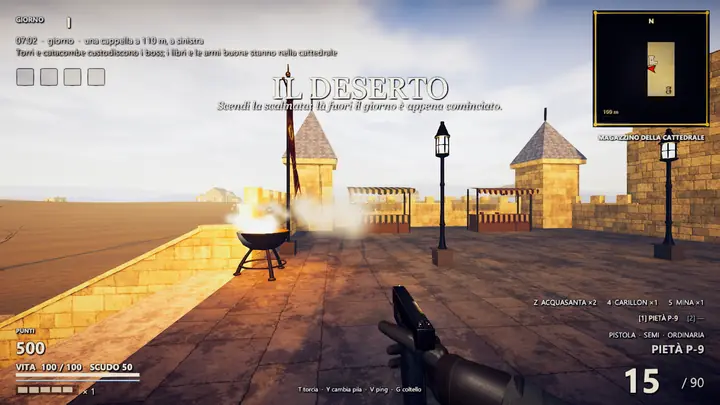

# Prying Eyes wiki

Prying Eyes is a game about a cathedral, what lies under it, and the sand around it. It has two ways to play. Both share the cathedral, its works and its market, the weapons, the saves and the menus; they differ in almost everything else. This wiki describes each part of the game and of the project that makes it. Every page has a picture, a one-line summary and links to the pages it names.

## Start here

- [Standard mode](modes/standard.md): the cathedral you rebuild, the catacombs under it, the waves and the trials.
- [The desert](modes/desert.md): an open world of sand built from one seed, with towers and catacombs on it, a motorbike and no waves.
- [Standard vs desert](standard-vs-desert.md): every page that differs between the two modes, with the difference in one line.
- [Glossary](glossary.md): the words of the game and of the project, each linked to its page.
- [Concept map](concept-map.md): how the main concepts connect, as a diagram you can follow.
- [Catalogue](catalog.md): every page, by class and kind.

## The game

- **Structures:** the [cathedral](zones/cathedral.md), the [catacombs](zones/catacombs.md), their [branches](branches/ossario.md) and the [Abyss](zones/abyss.md); in the desert, the [stacks](stacks/tower.md), the [regions](regions/dunes.md) and the [places](places/hotel.md).
- **Entities:** the [monk](enemies/monk.md) and the other walkers, the four bosses ([Cardinale](enemies/cardinale.md), [Direttore](enemies/direttore.md), [Primario](enemies/primario.md) and [Conte](enemies/conte.md)), the [lord of the place](enemies/signore-del-luogo.md), the [survivors](survivors/custode.md) and the [desert animals](creatures/lizard.md).
- **Objects:** the weapons in five grades, from the [Pietà P-9](weapons/pieta-p9.md) on, the [perks](systems/perks.md), the [grimoires](grimoires/witchcraft.md), the [blessings](systems/blessings.md), the [throwables](throwables/holy-water.md), the [traps](traps/reliquary-mine.md), the [resources](resources/reliquie.md) and the [motorbike](vehicles/moto.md).
- **Systems:** the [wave cycle](cycles/wave-cycle.md), the [candle cycle](cycles/candle-cycle.md), the [trials](trials/testa.md), [stealth](systems/stealth.md), [points and oboli](systems/points-and-oboli.md), the [minimap](systems/minimap-and-way-home.md), [co-op](systems/co-op.md), [split screen](systems/split-screen.md) and [characters and saves](systems/saves-and-characters.md).

## The project

- **Pipeline and tools:** the [studio engine](pipeline/studio-engine.md), the [check suite](pipeline/check-suite.md), [ship](pipeline/ship.md), the [CI gate](pipeline/ci-gate.md), the [labs](pipeline/labs.md), the [Blender models](pipeline/blender-models.md), the [release](pipeline/release.md) and the [wiki generator](pipeline/wiki-generator.md).
- **Packages:** the [saves](packages/saves.md), [weapons](packages/weapons.md), [economy](packages/economy.md), [survival](packages/survival.md) and [layout](packages/layout.md) packages.
- **Projects and history:** the [Unity game](projects/unity-game.md), the [city prototype](projects/city-prototype.md), the [Unreal prototype](projects/unreal-prototype.md), the [earlier versions](projects/legacy-versions.md), the [survival redesign](projects/zombies-redesign.md), the [quality audit](projects/quality-audit.md) and the [trailer](projects/trailer.md).

## How this wiki is made

The pages are the Markdown files under `wiki/`. The [wiki generator](pipeline/wiki-generator.md), run as `tools/wiki_site.py`, checks them and builds the catalogue, the graph for tools and the static site in `wiki/site/`, which opens in a browser without a server. The pictures are rendered from a manifest by `tools/wiki_images.py`.
