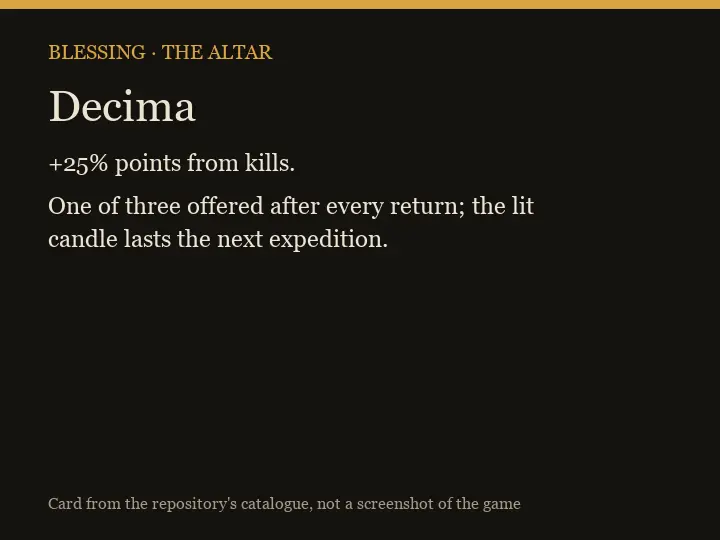

# Decima

Decima (*tithe*) is one of the six blessings of the altar. Lit on the altar, the points you earn from kills are 25% higher for the next
expedition.

## What it does

- **Points.** +25% from kills.
- **Duration.** The next expedition.

## How it is offered

- **Offer.** After every return from the catacombs three of the six are offered; you light one, and it lasts the next expedition.

## Standard and desert

- **Standard.** The altar and its blessings belong to the catacomb expeditions.
- **Desert.** The desert code does not offer blessings, so Decima is not offered there.

## Related

- [Blessings](../systems/blessings.md): the six blessings and how they are offered.
- [Points and oboli](../systems/points-and-oboli.md): the points that Decima raises.
- [Offerta](../power-ups/offerta.md): the power-up that doubles the points for a while.
