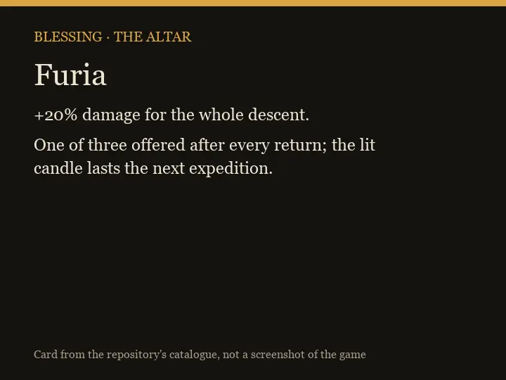

# Furia

Furia (*fury*) is one of the six blessings of the altar. Lit on the altar, it adds 20% damage for the next expedition.

## What it does

- **Damage.** +20% to everything you deal.
- **Duration.** The next expedition in the catacombs. The blessing that is lit lasts until then.

## How it is offered

- **Offer.** After every return from the catacombs three of the six are offered; you light one, and it lasts the next expedition.

## Standard and desert

- **Standard.** The altar and its blessings belong to the catacomb expeditions, and the code that offers them is in the catacomb floors.
- **Desert.** The desert code does not offer blessings (the desert folder does not mention them), so Furia is not offered there.

## Related

- [Blessings](../systems/blessings.md): the six blessings and how they are offered.
- [The Altare maggiore](../works/laltare-maggiore.md): the altar that offers them.
- [Grazia](grazia.md): the blessing of health, the other one for the fight.
