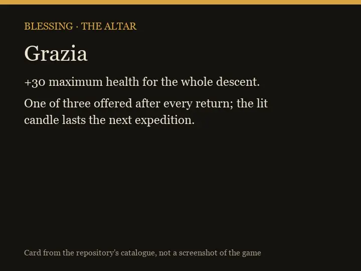

# Grazia

Grazia (*grace*) is one of the six blessings of the altar. Lit on the altar, it adds 30 to your maximum health for the next expedition.

## What it does

- **Health.** +30 maximum health.
- **Duration.** The next expedition in the catacombs.

## How it is offered

- **Offer.** After every return from the catacombs three of the six are offered; you light one, and it lasts the next expedition.

## Standard and desert

- **Standard.** The altar and its blessings belong to the catacomb expeditions.
- **Desert.** The desert code does not offer blessings, so Grazia is not offered there.

## Related

- [Blessings](../systems/blessings.md): the six blessings and how they are offered.
- [The Altare maggiore](../works/laltare-maggiore.md): the altar that offers them.
- [Pelle di pietra](../perks/pelle-di-pietra.md): the perk that also adds health.
