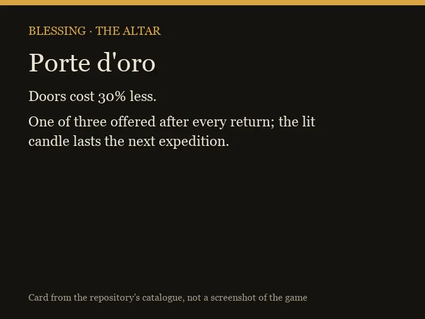

# Porte d'oro

Porte d'oro (*golden doors*) is one of the six blessings of the altar. Lit on the altar, the paid doors of the catacombs cost 30% less for
the next expedition.

## What it does

- **Doors.** The paid doors cost 30% less.
- **Duration.** The next expedition.

## How it is offered

- **Offer.** After every return from the catacombs three of the six are offered; you light one, and it lasts the next expedition.

## Standard and desert

- **Standard.** The paid doors are the catacomb floors' doors, and the blessing lowers their price.
- **Desert.** The desert code does not offer blessings, so Porte d'oro is not offered there; the desert's own door prices are in [the desert](../modes/desert.md).

## Related

- [Blessings](../systems/blessings.md): the six blessings and how they are offered.
- [The area door](../doors/area-door.md): the paid door that the blessing makes cheaper.
- [Furia](furia.md): the blessing of damage.
