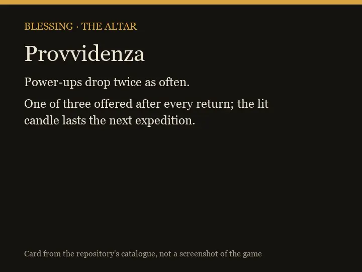

# Provvidenza

Provvidenza (*providence*) is one of the six blessings of the altar. Lit on the altar, the power-ups drop twice as often for the next expedition.

## What it does

- **Power-ups.** Twice as often as usual.
- **Duration.** The next expedition.

## How it is offered

- **Offer.** After every return from the catacombs three of the six are offered; you light one, and it lasts the next expedition.

## Standard and desert

- **Standard.** The altar and its blessings belong to the catacomb expeditions, and the power-ups drop on the catacomb floors.
- **Desert.** The desert code does not offer blessings, so Provvidenza is not offered there.

## Related

- [Blessings](../systems/blessings.md): the six blessings and how they are offered.
- [Power-ups](../power-ups/reliquiario.md): the drops that it doubles.
- [Raccolto](raccolto.md): the blessing of the resources.
