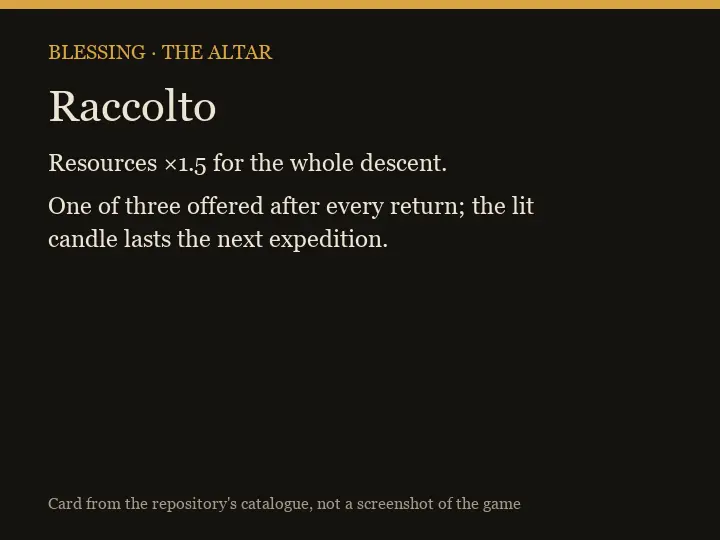

# Raccolto

Raccolto (*harvest*) is one of the six blessings of the altar. Lit on the altar, it multiplies the resources you gather by 1.5 for the next
expedition.

## What it does

- **Resources.** ×1.5 on the resources you gather in the catacombs.
- **Duration.** The next expedition.

## How it is offered

- **Offer.** After every return from the catacombs three of the six are offered; you light one, and it lasts the next expedition.

## Standard and desert

- **Standard.** The altar and its blessings belong to the catacomb expeditions.
- **Desert.** The desert code does not offer blessings, so Raccolto is not offered there.

## Related

- [Blessings](../systems/blessings.md): the six blessings and how they are offered.
- [Ossa](../resources/ossa.md): one of the resources it multiplies.
- [Provvidenza](provvidenza.md): the blessing of the power-ups.
