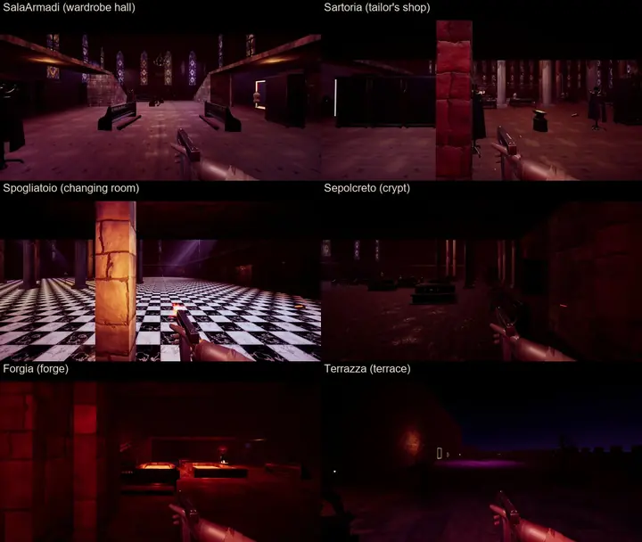

# Il Guardaroba del Conte (branch IV)

The fourth branch is the wardrobe of the Count: wardrobes, vampires, scissors and lava, with open-air terraces over a lake of lava. It
was added on 16 November 2026, as the fourth theme after the hotel, the theatre and the sanatorium.

## Its levels and boss

- **Theme:** wardrobe, with 17 props of its own (`gu_*`): a wardrobe hall, a changing room, a tailor's shop, a forge, a crypt with
  coffins and the terraces.
- **Gate:** [Il Cancello del Conte](../works/il-cancello-del-conte.md), which needs the sanatorium gate and, among its costs, one
  faith crystal.
- **Boss:** [Il Conte](../enemies/conte.md), the [Cardinale](../enemies/cardinale.md) in crimson and black, on the third level.
- **Its resource:** gems, which only the Conte drops; the window [La Vetrata del Conte](../works/la-vetrata-del-conte.md) uses them.

## Standard and desert

Only the standard game has branches, so this one does not exist in the desert. In the Tower the theme is off by default: no floor is a
Guardaroba unless it is asked for, so the Tower plays as it did before the theme was added. See [the desert](../modes/desert.md).

## Related

- [The catacombs](../zones/catacombs.md): the four branches and the [Abyss](../zones/abyss.md).
- [Il Sanatorio](sanatorio.md): the branch before this one.
