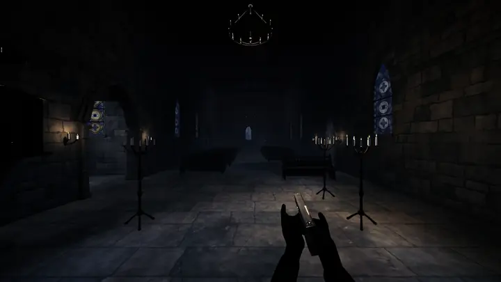

# L'Ossario (branch I)

The first branch is open from the beginning: its gate is the one that needs no work. Its floors are the hotel and the church of the
old Tower, and the difficulty of its three levels is that of floors 1 to 3 of the Tower.

## Its levels and boss

- **Theme:** hotel and church.
- **Gate:** open from the start; the crypt work [L'Ossario](../works/lossario.md) makes death gentler here and everywhere.
- **Boss:** [Il Cardinale](../enemies/cardinale.md), on the third level, after the three waves that open its gate. The boss has at
  least the hit points of the eighth-wave Cardinale, plus 25% for each branch.
- **Its resource:** the [reliquie](../resources/reliquie.md) (relics), which only this boss drops. The first kill secures three of them
  in the store, the next ones two.

## Standard and desert

Only the standard game has branches, so this one does not exist in the desert, whose towers and catacombs are [stacks](../stacks/tower.md)
with their own bosses. The Cardinale also appears in the standard waves, and the desert does not use the wave cycle; see
[the desert](../modes/desert.md).

## Related

- [The catacombs](../zones/catacombs.md): the four branches and the [Abyss](../zones/abyss.md).
- [Il Teatro sepolto](teatro-sepolto.md): the second branch, opened by the theatre gate.
- [Levels](../levels/first-level.md): what each level of a branch holds.
