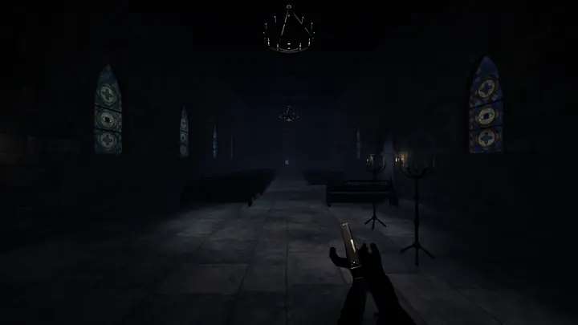

# Il Sanatorio (branch III)

The third branch is an institute: reception with its hatch, wards with iron beds in rows, cells, a refectory, an operating room
under a surgical lamp, a morgue. The linoleum is green and the plaster cold, and the fluorescent tubes flicker, a third of them dead.

## Its levels and boss

- **Theme:** sanatorium. Trolleys, drip stands and screens stand against the walls; a wheelchair waits at reception.
- **Gate:** [Il Cancello del Sanatorio](../works/il-cancello-del-sanatorio.md), which needs the theatre gate and costs a darkness crystal.
- **Enemies:** the monks and the abbots are replaced by the [Infermiere](../enemies/infermiere.md), a nurse whose needle slows you, and
  the [Primario](../enemies/primario.md), a chief physician who calls two nurses to help him.
- **Boss:** the Primario, on the third level, after the three waves that open its gate.
- **Its resource:** [cristalli di fede](../resources/cristalli-di-fede.md) (faith crystals), which only the Primario drops.

## Standard and desert

Only the standard game has this branch. The desert has no branch, but its sanatoria, and the towers given the sanatorium theme, have the [Infermiere](../enemies/infermiere.md): 45% of their walkers are nurses. The [Primario](../enemies/primario.md) is one of the four bosses that the [lord of the place](../enemies/signore-del-luogo.md) draws by place. See [the desert](../modes/desert.md).

## Related

- [Il Teatro sepolto](teatro-sepolto.md): the branch before this one.
- [Il Guardaroba del Conte](guardaroba.md): the fourth branch, opened by the Count's gate.
- [The catacombs](../zones/catacombs.md): the four branches and the [Abyss](../zones/abyss.md).
