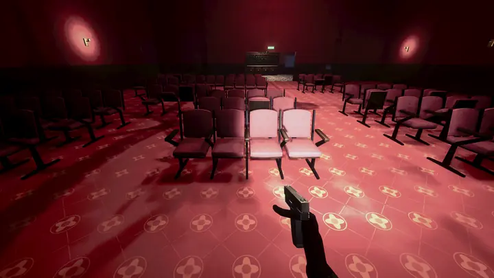

# Il Teatro sepolto (branch II)

The second branch is a theatre under the cathedral. Its floors are an auditorium with boxes and a foyer, a stage with its velvet
curtain and footlights, and the wings behind it with dressing rooms. The air is reddish and the orchestra tunes in the distance.

## Its levels and boss

- **Theme:** theatre. Rows of tip-up seats face the stage, and the stage has the Occhio d'oro on its backdrop.
- **Gate:** [Il Cancello del Teatro](../works/il-cancello-del-teatro.md), which costs a relic and 30 steel and 30 bones.
- **Enemies:** the monks and the abbots of the floors are replaced by the [Maschera](../enemies/maschera.md), an usher with a porcelain
  mask, and the [Direttore](../enemies/direttore.md), a conductor with a tuning fork; both are built on the monk's skeleton and clips.
- **Boss:** the Direttore, on the third level, after the three waves that open its gate.
- **Its resource:** [cristalli d'oscurità](../resources/cristalli-d-oscurita.md) (darkness crystals), which only the Direttore drops.

## Standard and desert

Only the standard game has this branch. The desert has no branch, but its theatres have the [Maschera](../enemies/maschera.md): 45% of their walkers are masks. The [Direttore](../enemies/direttore.md) is one of the four bosses that the [lord of the place](../enemies/signore-del-luogo.md) draws by place. See [the desert](../modes/desert.md).

## Related

- [L'Ossario](ossario.md): the first branch, which is open from the start.
- [Il Sanatorio](sanatorio.md): the third branch, opened by the sanatorium gate.
- [The catacombs](../zones/catacombs.md): the four branches and the Abyss.
