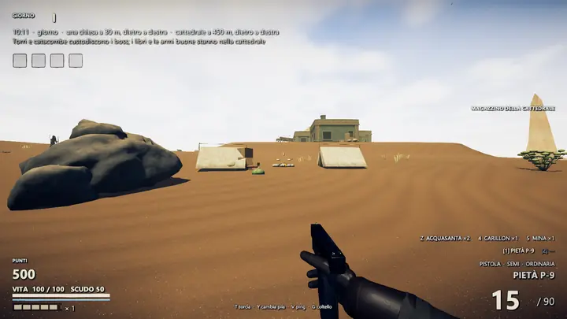

# The camp

A camp is a small place on the sand where someone stopped: a fire ringed with stones, one to three tents with their doors turned to the fire,
and a pile of supplies. It is one of the things that give the open desert its life.

## What it is

- **Fire.** By day the fire is out. At night it burns with a flickering light, smoke and sparks.
- **Tents.** One to three tents, each with its door turned to the fire.
- **Supplies.** A pile of supplies beside the tents.
- **Where.** Here and there on the open sand. At night the fire can be seen from afar, because of its light.

A camp's fire is the [campfire](campfire.md): the same fire, at night.

## Standard and desert

The standard game has no camps. Its rooms are lit by lamps and candles, and the candles of a round are lit by the player.

## Related

- [The campfire](campfire.md): the fire of the camp at night.
- [Day and night](../cycles/day-night.md) and [the sandstorm](../cycles/sandstorm.md): the cycles that change the camp.
- [The desert](../modes/desert.md): the open world as a whole.
