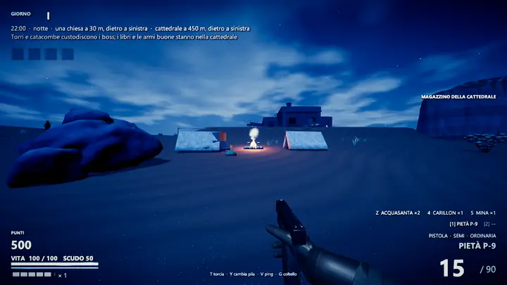

# The campfire

The campfire is the fire of a camp. By day it is out; at night it burns with a flickering light, smoke and sparks, and it is one of the
lights of the dark desert.

## What it does

- **Light.** The four nearest fires within 130 m each give a light to the sand and to the things on it.
- **Smoke and sparks.** Each burning fire has smoke and sparks.
- **Sound.** Its crackle is placed in space (3D) and heard within 34 m.
- **Danger.** The desert page says that the animals, the birds, the tumbleweeds and the weather hurt nobody, and calls the camps a place
  to find.

## Standard and desert

The standard game's light comes from candles, lamps and torches, and the candles of the round are lit by the player. The campfire exists
only in the desert.

## Related

- [The camp](camp.md): the place a campfire belongs to.
- [Day and night](../cycles/day-night.md): the cycle that makes the fire burn.
- [The sandstorm](../cycles/sandstorm.md): the weather that changes the fire's light.
- [The desert](../modes/desert.md): the open world as a whole.
