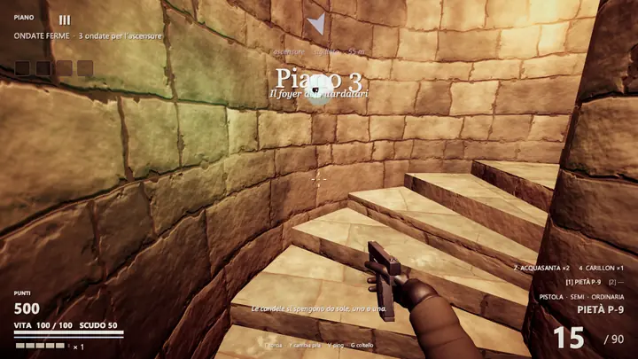

# The glass eye

The glass eye is a hidden collectible of the catacomb floors. There are three on every floor, and the scoreboard counts them. They float
at face height, glow faintly green and breathe, so you can hear them within a few metres.

## What it does

- **Where.** The first is inside the annexes (the tower, the crypt or the garden), the second is on the galleries, and the third is in the
  corners farthest from the arrival lift. They are at least 12 m apart, from the floor's seed.
- **Watching.** Within 9 m an eye turns to watch you.
- **Taking.** Press `F` or shoot it.
- **Reward.** With all three, the weapon in your hand is consecrated for free. If it is already consecrated, you get 3,500 points instead,
  and you get 1,000 points in any case.
- **Co-op.** Each player hunts their own eyes; the find is local, like the treasures of the annexes.

## Standard and desert

- **Standard.** Glass eyes are placed on the catacomb floors and nowhere else.
- **Desert.** The desert doc does not describe them. The consecration of the weapon there is the [Altar of Consecration](../works/altare-della-consacrazione.md),
  which is a work built with resources.

## Related

- [The Altar of Consecration](../works/altare-della-consacrazione.md): the other way to consecrate a weapon.
- [The catacombs](../zones/catacombs.md): the floors where the eyes hide.
- [Cathedrals and annexes](../systems/annexes.md): the annexes where the first eye waits.
