# Concept map

The map shows the main concepts of Prying Eyes and of the project that makes it, and how they connect. On the site each box links to its page, and each arrow reads as a sentence from its first concept to its second, with the label on the arrow: "Standard mode, starts in, the cathedral". The concepts and their relations are kept in `wiki/concepts.json`; the diagram below is generated from them.

Start from [Standard mode](modes/standard.md) or from [the desert](modes/desert.md). The [glossary](glossary.md) explains the words, and [standard vs desert](standard-vs-desert.md) says what differs between the two modes.

```mermaid
flowchart LR
  standard_mode["Standard mode"]
  desert_mode["The desert"]
  cathedral["The cathedral: base, works and market"]
  catacombs["The catacombs"]
  abyss["The Abyss (fifth gate)"]
  branches["Four branches of the catacombs"]
  boss_cardinale["Cardinale: branch I"]
  boss_direttore["Direttore: branch II"]
  boss_primario["Primario: branch III"]
  boss_conte["Conte: branch IV"]
  wave_cycle["Wave cycle (default)"]
  candle_cycle["Candle cycle (-candles)"]
  stealth["Stealth"]
  trials["Trials of the waves"]
  procession["Procession of lights"]
  points["Points and oboli"]
  satchel["Satchel"]
  perks["Perks in magic books"]
  grimoires["Grimoires: spells and seals"]
  blessings["Altar blessings"]
  annexes["Annexes"]
  library_vows["Library of Vows"]
  consecration["Altar of Consecration"]
  weapons["Weapons in five grades"]
  stacks["Towers and catacombs on the sand"]
  day_night["Day and night"]
  sandstorm["Sandstorm"]
  motorbike["Motorbike"]
  minimap["Minimap and way home"]
  lord_of_place["Lord of the place (desert boss)"]
  walkers["Walkers: monks and their kin"]
  survivors["Four survivors"]
  coop["Online co-op"]
  split_screen["Split screen"]
  saves["Characters and saves"]
  game["The Unity game"]
  city["City prototype"]
  unreal["Unreal prototype"]
  redesign["Survival redesign"]
  pipe_engine["Studio engine"]
  pipe_check["Check suite"]
  pipe_ship["Ship"]
  pipe_gate["CI gate"]
  pipe_labs["Labs"]
  pipe_models["Blender models"]
  pkg_saves["Production Saves package"]
  pkg_weapons["Production Weapons package"]
  pkg_economy["Production Economy package"]
  pkg_survival["Production Survival package"]
  standard_mode -- "starts in" --> cathedral
  cathedral -- "gates lead down to" --> catacombs
  catacombs -- "consists of" --> branches
  catacombs -- "fifth gate" --> abyss
  branches -- "boss of" --> boss_cardinale
  branches -- "boss of" --> boss_direttore
  branches -- "boss of" --> boss_primario
  branches -- "boss of" --> boss_conte
  standard_mode -- "plays by" --> wave_cycle
  standard_mode -- "legacy option" --> candle_cycle
  candle_cycle -- "has" --> stealth
  stealth -- "governs" --> walkers
  wave_cycle -- "offers" --> trials
  wave_cycle -- "every fifth wave" --> procession
  wave_cycle -- "every eighth wave" --> boss_cardinale
  annexes -- "built into" --> wave_cycle
  catacombs -- "carried through" --> satchel
  satchel -- "banks on return" --> points
  points -- "buys" --> perks
  perks -- "come in" --> grimoires
  blessings -- "offered before each descent" --> catacombs
  desert_mode -- "builds as" --> stacks
  stacks -- "guarded by" --> lord_of_place
  desert_mode -- "has a clock of" --> day_night
  desert_mode -- "blows in" --> sandstorm
  desert_mode -- "one for each player" --> motorbike
  minimap -- "guides through" --> desert_mode
  desert_mode -- "walkers roam" --> walkers
  desert_mode -- "has in its cathedral" --> library_vows
  desert_mode -- "has in its cathedral" --> consecration
  library_vows -- "sells" --> perks
  consecration -- "consecrates" --> weapons
  weapons -- "sold in the desert's armoury" --> cathedral
  survivors -- "ride" --> motorbike
  coop -- "one world per seed" --> desert_mode
  coop -- "is played locally as" --> split_screen
  split_screen -- "one expedition per seat" --> desert_mode
  saves -- "keeps the progress of" --> standard_mode
  saves -- "keeps nothing of" --> desert_mode
  game -- "plays" --> standard_mode
  game -- "plays" --> desert_mode
  city -- "lives in" --> game
  unreal -- "rebuilds one room of" --> game
  redesign -- "produced" --> wave_cycle
  pipe_models -- "feeds" --> game
  pipe_engine -- "builds" --> city
  pipe_engine -- "runs as jobs" --> pipe_labs
  pipe_ship -- "runs before a commit" --> pipe_check
  pipe_gate -- "runs" --> pipe_check
  pipe_gate -- "runs" --> pipe_labs
  pipe_labs -- "tests" --> pkg_saves
  pipe_labs -- "tests" --> pkg_weapons
  pipe_labs -- "tests" --> pkg_economy
  pipe_labs -- "tests" --> pkg_survival
  game -- "uses" --> pkg_saves
```

<!-- concept-map:begin -->

<!-- concept-map:end -->
