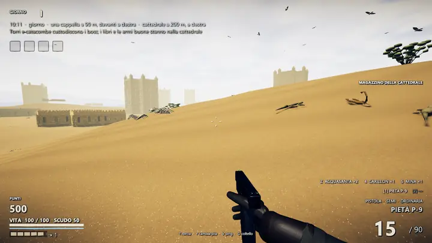

# The lizard

The lizard is one of the small animals of the open sand. It lives on the sand by day and runs away when you come near.

## What it is

- **Where.** On the open sand, by day.
- **Flight.** It runs away when you come within 6.5 m (the desert page).
- **Harm.** None: the animals of the desert hurt nobody.
- **Storms.** It takes shelter when a sandstorm comes.

## Standard and desert

- **Standard.** The standard game has no animals of this kind: the code that places them, `DesertLife`, belongs to the desert.
- **Desert.** It lives with the scarab and the scorpion on the open sand, and the vultures and bats over the ruins. See [the desert](../modes/desert.md).

## Related

- [The scarab](scarab.md) and [the scorpion](scorpion.md): the other ground animals.
- [The vulture](vulture.md): the birds of the ruins.
- [The sandstorm](../cycles/sandstorm.md): the weather that sends the animals into shelter.
