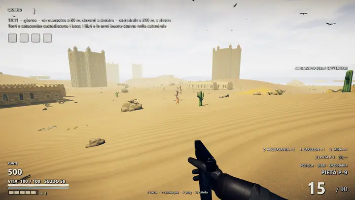

# The scarab

The scarab is a beetle of the open sand. By day it moves about on the sand, and it runs away when you come near.

## What it is

- **Where.** On the open sand, by day.
- **Flight.** It runs away when you come within 6.5 m, the same distance as the lizard.
- **Harm.** None.

## Standard and desert

- **Standard.** There are no scarabs in the standard game: the animals are placed by `DesertLife`, which belongs to the desert.
- **Desert.** It lives with the lizard and the scorpion. See [the desert](../modes/desert.md).

## Related

- [The lizard](lizard.md) and [the scorpion](scorpion.md): the other ground animals.
- [The vulture](vulture.md): the birds that circle the ruins.
- [The day and night cycle](../cycles/day-night.md): the animals are seen by day.
