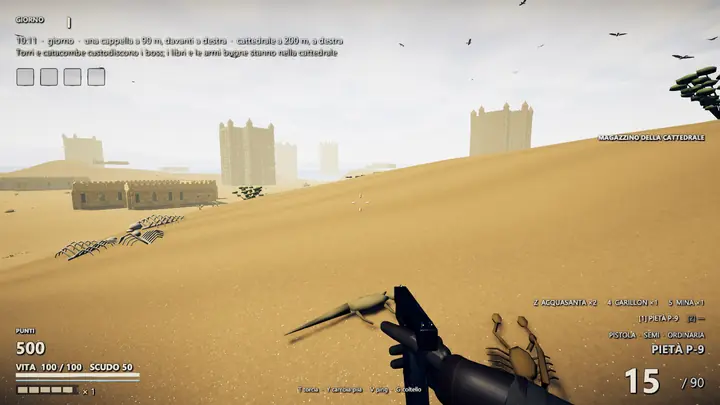

# The scorpion

The scorpion is a ground animal of the open sand. By day it lives on the sand, and it runs away when you come near, from a shorter distance
than the lizard or the scarab.

## What it is

- **Where.** On the open sand, by day.
- **Flight.** It runs away when you come within 3.8 m, against 6.5 m for the lizard and the scarab.
- **Harm.** None: it does not attack, and it hurts nobody, as the desert page says of all the animals.

## Standard and desert

- **Standard.** There are no scorpions in the standard game: the animals are placed by `DesertLife`, which belongs to the desert.
- **Desert.** It lives with the lizard and the scarab. See [the desert](../modes/desert.md).

## Related

- [The lizard](lizard.md) and [the scarab](scarab.md): the other ground animals.
- [The vulture](vulture.md): the birds of the ruins.
- [The sandstorm](../cycles/sandstorm.md): the weather that sends the animals into shelter.
