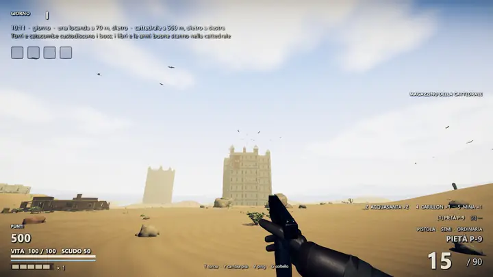

# The vulture

The vulture is the bird of the open desert. It circles over the ruins and the towers, always over the same ones, and it is one of the sounds
of the day: a caw from the flock nearest to you.

## What it is

- **Flocks.** Up to five flocks within 700 m, each always over the same ruins or towers.
- **Sound.** By day a vulture caws from the flock that circles the nearest ruin.
- **Night.** At night the bats take the vulture's place over the ruins (`DesertLife`).
- **Harm.** None.

## Standard and desert

- **Standard.** The standard game has no birds of this kind: the flocks are placed by `DesertLife`, which belongs to the desert.
- **Desert.** The flocks are part of the open world: see [the desert](../modes/desert.md) and [the towers](../stacks/tower.md) where they circle.

## Related

- [The lizard](lizard.md), [the scarab](scarab.md) and [the scorpion](scorpion.md): the ground animals.
- [The day and night cycle](../cycles/day-night.md): the change from the vultures to the bats.
- [The campfire](../camps/campfire.md): the crackle that the vultures' caw follows at dusk.
