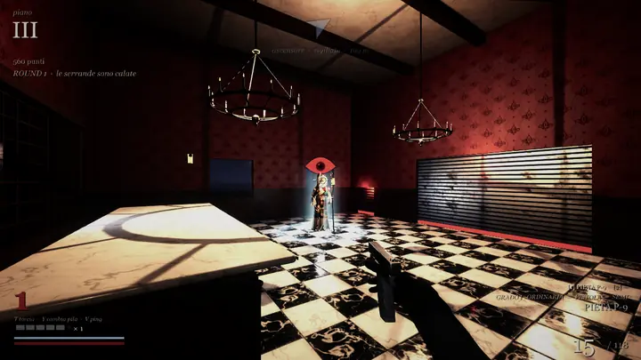

# The candle cycle

The candle cycle is the legacy way of playing the tower. It has been the old progression since the wave cycle became the default on 13 November 2026, and it stays behind the `-candles` flag. It is the cycle that has [stealth](../systems/stealth.md).

## How to play

- **Candles.** Each floor has two to four candelabra to light with `F`, one per arena, each marked by a cold halo. With `-oldplan` there are 4 up to the second floor and then 6, scattered through the rooms.
- **Calling enemies.** Lighting them calls enemies. When they are all lit, the exit lift opens with a bonus, and you can go down.
- **Buying.** Weapons are bought with points at the three wall displays of each floor.
- **Death.** If you die you respawn at the arrival lift on the same floor.

## Rounds

Many candles stand in a zone that can be sealed. Lighting the candle of a zone drops steel shutters over all its exits and starts a round, and the round's enemies spawn inside. A round is:

- **Calm**, if no priest knew about you: fewer enemies, starting after 6 seconds, with 150 bonus points.
- **On alert**, if someone was already searching for you: more enemies, at once.

When all the round's enemies are down, the shutters rise and the reward is 100 points plus 20 per round, with the shield full and a quarter of the ammunition. If you die, the round is cancelled, the candle goes out again, and the round does not count.

## Standard and desert

- **Standard.** Only with `-candles` (or `-legacycycle`). The wave cycle is the default.

## Related

- [The wave cycle](wave-cycle.md): the default that replaced it.
- [Stealth](../systems/stealth.md): the rules that make this cycle a game of patience.
- [Floor power](../systems/floor-power.md): this cycle starts with the power on.
- [Points and oboli](../systems/points-and-oboli.md): the candle and round rewards.
