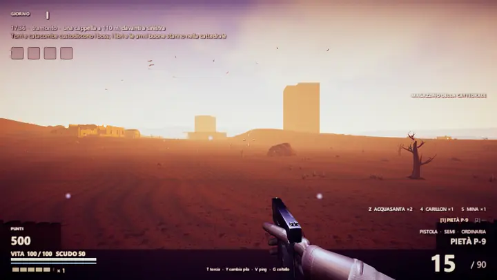

# Day and night

A day in the desert lasts twenty minutes: about twelve of daylight and eight of night. The sun, the moon, the stars and the fog follow the hour. In co-op the host's clock is the one everyone sees.

## What changes

- **Light and fog.** The fog is thin by day and thick at night, and at night the sky has stars and a moon.
- **Phases.** The objective line names the hour and the phase (dawn, day, dusk, night) and the nearest place.
- **Enemies.** Most of them rest by day, wandering in their zone without noticing anything, until you come within 30 m (48 m at night), or someone hits them. They are few by day and many at night.
- **Sound.** At night the crickets sing from dusk, and now and then a howl comes from far off. By day a vulture caws over the nearest ruin.
- **Camps.** By day the fire of a camp is out. At night it burns with a flickering light, smoke and sparks, and bats take the place of the vultures in the air.
- **Chart.** The minimap turns blue and dark at night (see [Minimap and way home](../systems/minimap-and-way-home.md)).

## Standard and desert

- **Desert.** The clock runs in the desert, under a sky that goes through day and night.
- **Standard.** The floors of the tower have no sky, and so no day or night.

## Related

- [Sandstorm](sandstorm.md): the weather of the same desert.
- [Co-op](../systems/co-op.md): the hour is shared by everyone.
- [The desert](../modes/desert.md): the mode these belong to.
