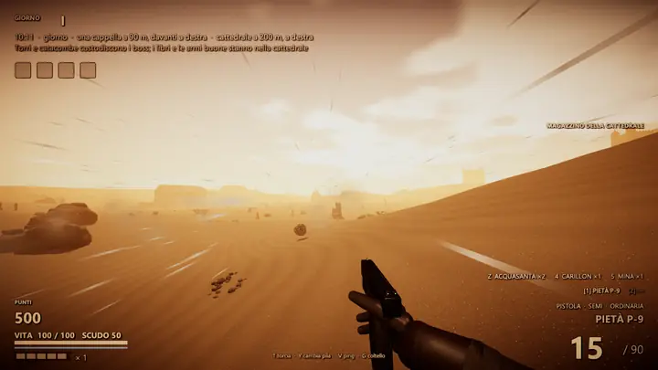

# Sandstorm

About one day in two the desert has a sandstorm, between 08:00 and 22:00, and never before noon of the first day. It lasts 75 to 160 seconds of play.

## What it does

- **Fog and sun.** The fog gets up to 3.8 times thicker by day, and the sun loses half its strength.
- **Sky.** The sky and the fog turn the colour of sand.
- **Dust.** Streaks and clouds of sand fly past, through the particle systems `DesertWeather` and `DesertDust`.
- **Animals.** The animals take shelter. By day, lizards, scorpions and beetles live on the sand and run away when you come near.
- **Sound.** The hiss of the sand joins the wind, and the crickets stop.
- **Wind.** The wind blows all day: it bends the bushes, rolls the tumbleweeds and turns the windmills.

## Standard and desert

- **Desert.** The only place with weather. The standard floors have none.

## Related

- [Day and night](day-night.md): the hours a storm falls in.
- [The desert](../modes/desert.md): the mode these belong to.
- [Minimap and way home](../systems/minimap-and-way-home.md): the chart in the sand.
