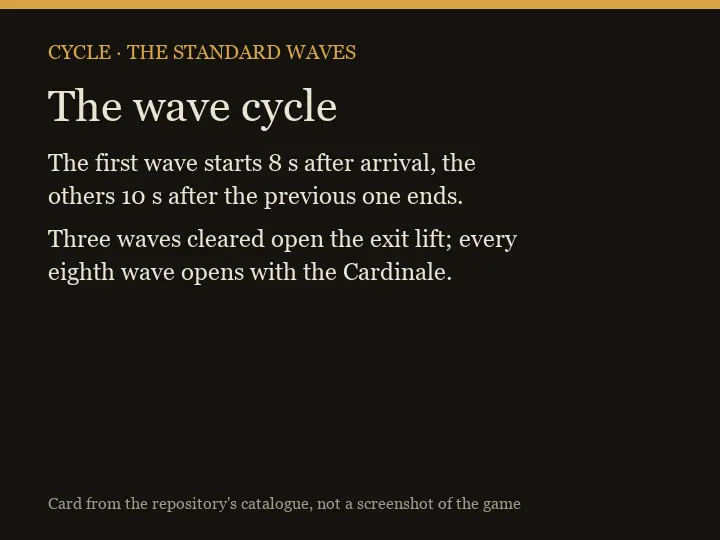

# The wave cycle

The wave cycle is the default way of playing the tower. It works like Call of Duty: Zombies: there are no candles to light and no stealth. There is no alert, no detection tied to light, no ghost bonus and no takedown. The knife is only a close-range hit.

## How a wave runs

- **Timing.** The first wave starts 8 seconds after arrival, and each later one 10 seconds after the previous one ends. The number of the wave shows in red at the bottom left.
- **Enemies.** Each wave brings 16 enemies, plus 4 per wave, plus 8 for each player beyond the first, between 20 and 100. At most 12 plus 1 per wave, plus 3 per extra player, are alive at once, between 14 and 28.
- **Spawns.** They appear only in the areas already open, 7 to 28 m from the players, out of sight while good spots exist.
- **Speed.** They are always aggressive. Their speed rises from 1.6 times at wave 1 to 2.2 times at wave 10 and stays there. Flying enemies are 15% faster again.
- **Reward.** A cleared wave pays 100 points plus 20 per wave, for everyone. The shield is refilled to 50, and a quarter of the ammunition comes back.
- **Death.** If the player dies (in co-op, if everyone dies) the wave is cancelled with no reward, and the wave number goes back by one. Going down is not dying: while someone is down but alive, the wave goes on.
- **Exit.** Three cleared waves open the exit lift in the boss area. You can keep fighting and buying after that.

## Special waves and trials

- Every fifth wave is the **Processione dei Lumi**, a procession of lights.
- Every eighth wave opens with the **Cardinale**.
- Each wave but the first offers a trial on every other wave from the second on, and not during the procession. See [the trials](../trials/testa.md).

## Areas

Rooms are sealed behind doors that you open with points. The first area costs 500 points; each further area costs 250 more per step of distance from the start, up to 1,500. Two doors between the same areas open together.

## Standard and desert

- **Standard.** The default cycle of the tower.
- **Desert.** The desert has no waves. Its time and weather are the [day and night](../cycles/day-night.md) and the [sandstorm](../cycles/sandstorm.md).

## Related

- [The candle cycle](candle-cycle.md): the cycle this one replaced as the default.
- [Floor power](../systems/floor-power.md): the floors start with emergency lighting.
- [Points and oboli](../systems/points-and-oboli.md): the rewards and the costs.
- [Perks](../systems/perks.md): the libraries of the wave cycle.
