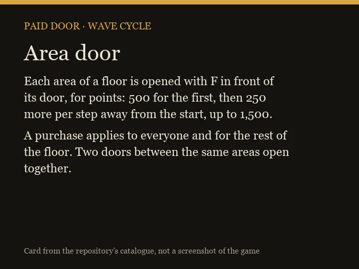

# Area door (paid door)

On the floors of the Tower and the catacombs the rooms are grouped in areas, and each area is shut by a wax-sealed door. You open it with
points, standing in front of it and pressing `F`.

## What it costs

- **The first area** of a floor costs 500 points.
- **Each further area** costs 250 more for each step of distance from the start beyond the first, up to 1500 points.
- **Two doors** between the same two areas open together, and the lifts open with their area.
- **The purchase is for everyone**, and it stays bought for the rest of the floor.

In co-op, whoever stands in front of the door pays, and the guest confirms the purchase: the starting area must be connected, the price
must be right, and the buyer must stand within 4.5 metres. From farther away it is refused and the points come back.

## What changes the price

- The cathedral's [Vetrata del Direttore](../works/la-vetrata-del-direttore.md) makes area doors cost 25% less.
- The blessing [Porte d'oro](../blessings/porte-d-oro.md) makes doors cost 30% less for the descent.

## Standard and desert

Only the standard game has area doors. The desert page does not describe paid doors; see [the desert](../modes/desert.md).

## Related

- [The first level](../levels/first-level.md): where the first doors of a branch stand.
- [Points](../pickups/points.md): what the doors spend.
- [The shop room](../rooms/shop-room.md): the other place where points are spent.
