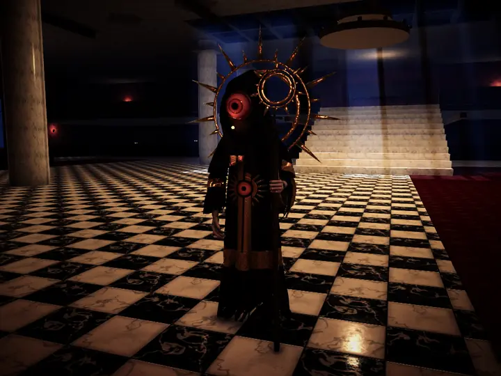

# The abbot

The abbot (*l'abate*) is the monk enlarged and dressed in black and gold. It is heavier than the monk: its charge, its lunge and its
recovery are slower, and its chant is a litany an octave lower.

## What it is

- **Hit points.** 320.
- **Size.** Its model is scaled to 1.3 times the monk's width, and its navigation body is 2.4 m tall, against 2 m for a monk (`Enemy.cs`).
- **Drops.** Steel as the common resource, and hearts as a rare one (cathedral doc).
- **Cardinale.** The eighth-wave [Cardinale](cardinale.md) is built on the abbot's body, at 1.18 times its size (horde doc).

## Standard and desert

- **Standard.** In the procedural floors of the catacombs (the Tower of the docs) an abbot can be the guardian of the exit lift.
  On the theatre floors the [Direttore](direttore.md) takes its place, and on the sanatorium floors the [Primario](primario.md) does.
- **Desert.** The abbot joins the walkers from about 450 m from the cathedral (danger 1.3), and its share grows with the distance.
  It rests like the other walkers until something wakes it.

## Related

- [The monk](monk.md): the body it is made from.
- [The Cardinale](cardinale.md): the eighth-wave boss, built on the abbot's body.
- [The Direttore](direttore.md) and [the Primario](primario.md): the themed bosses that take the abbot's place on their floors.
- [The desert](../modes/desert.md): where the walkers rest and wake.
