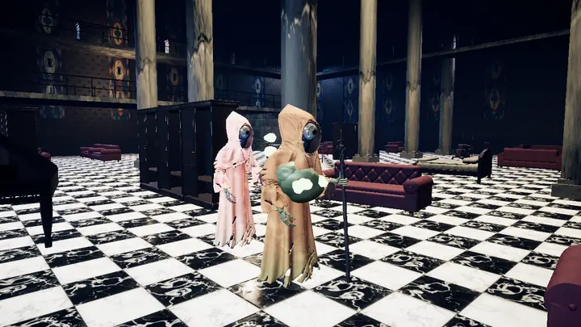

# The Appestato

The Appestato (the plague bearer) is a variant of the monk: a slow, bloated figure in a sickly robe, with a swollen belly and glowing
pustules. It is a bomb in a robe. It bursts when it comes within 1.9 m of a player, and it bursts again when it is killed.

## What it is

- **Hit points.** 230 (`Enemy.Varianti.cs`).
- **Pace.** Slow.
- **Burst.** Within 3.6 m and in line of sight it hurts a player for 34 down to 10 damage, depending on the distance, and it hurts every
  enemy in range for 320 down to 90. It then leaves a toxic cloud for 6.5 seconds: 8 damage a second to players and 60 to enemies.
- **Killing it.** Shooting it inside a horde is the point. A burst it sets off on itself pays nothing; a kill made by its burst or its cloud
  pays like a gun kill.
- **Barrels.** Its burst sets off the barrels in range, as the carillon does.

## Standard and desert

- **Standard.** The wave cycle draws it from the fourth wave: 5% of the spawns, plus 1% per wave, up to 14%.
- **Desert.** It joins the walkers from about 1,200 m from the cathedral (danger 1.8), with a weight of 7 in the mix.

## Related

- [The monk](monk.md): the body it is built on.
- [The Flagellante](flagellante.md) and [the Statua](statua.md): the other variants, of the wave cycle and of the desert.
- [The wave cycle](../cycles/wave-cycle.md): where the variants are drawn.
- [The desert](../modes/desert.md): where the walkers rest and wake.
