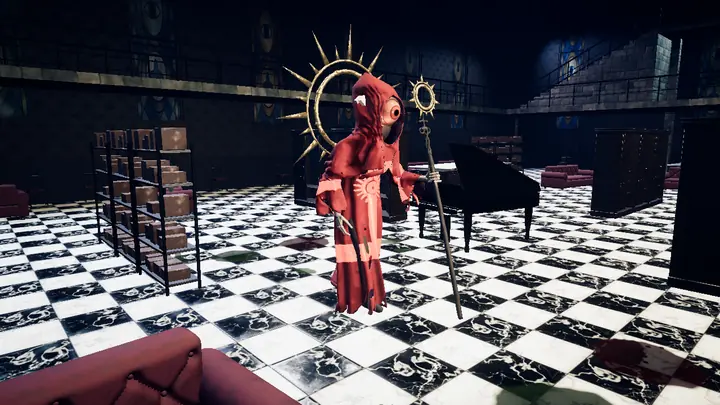

# The Cardinale

The Cardinale is the boss of the cathedral's waves. It opens every eighth wave of the wave cycle, and it guards the first branch of the
catacombs, the Ossario. It is built on the [abbot](abbot.md)'s body at 1.18 times its size, and its name and health bar stay at the top of
the screen while it lives.

## What it is

- **Hit points.** On the eighth wave: 3,200, plus 1,300 for each player beyond the first, plus 120 for each wave (`RoundDirector.Survival.cs`).
  As a branch boss the same sum is multiplied by 1 plus 0.25 times the branch's index: 1 for the Ossario, 1.75 for the Guardaroba.
- **Fire ring.** Telegraphed for 1.1 s, it hurts everything within 7 m for 22 to 28 damage.
- **Fan.** Five bolts, seven when it is enraged.
- **Summons.** Three or four monks.
- **Enrage.** Below half its hit points it moves 1.35 times faster and its cooldowns are 0.7 times as long.
- **Size.** Its navigation body is 2.9 m tall, the tallest of the family.
- **Reward.** On the eighth wave, 1,000 points to the killer and a Max Ammo drop; its drops are 6 to 10 common resources and 1 or 2 rare ones.

## Standard and desert

- **Standard.** It opens every eighth wave (not the processions), and it is the boss of branch I, the Ossario. Its gate, the first one, opens
  when the wave is cleared; the trophy is three [Reliquie](../resources/reliquie.md) the first time and two after, with 12 to 18 common and 3 rare resources.
- **Desert.** The Cardinale is one of the four bosses the stacks draw by place: the one of the Ossario, and the Conte's body in the
  Guardaroba. Its trophy goes to the store. See [the lord of the place](signore-del-luogo.md).

## Related

- [The abbot](abbot.md): the body the Cardinale is built on.
- [The Conte](conte.md): the same body, in the Guardaroba.
- [The Ossario](../branches/ossario.md): the first branch and its boss.
- [The wave cycle](../cycles/wave-cycle.md): where the eighth wave comes from.
