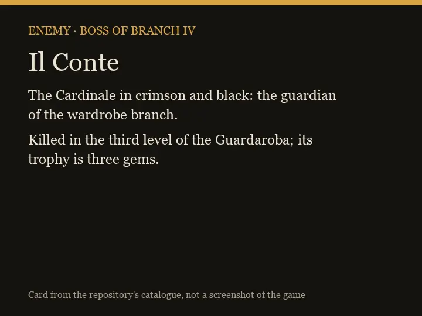

# The Conte

The Conte (the count) is not a type of its own in the code: it is the [Cardinale](cardinale.md) with the title and the look of the fourth branch,
the Guardaroba del Conte. The cathedral doc calls it "the Cardinale in crimson and black".

## What it is

- **Body.** The Cardinale's: the same hit points, attacks, enrage and size (see the Cardinale page).
- **Hit points.** As a branch boss, the Cardinale's formula times 1.75, since the Guardaroba is the fourth branch.
- **Colour.** The code multiplies the base colour of its materials by a dark red, which makes the robe crimson; the docs also describe black.
- **Title.** Its name on the top bar is "Il Conte".
- **Trophy.** Gems: a boss's trophy is three of its resource the first time and two after, with common and rare resources.

## Standard and desert

- **Standard.** It guards branch IV, the [Guardaroba](../branches/guardaroba.md), behind the Cancello del Conte, which costs 60 steel, 5 blood
  and one faith crystal. Its gems build the Vetrata del Conte, which makes the perk books cost 40% less.
- **Desert.** It is one of the four bosses the stacks draw by place, and the only one the code colours differently from the others: see
  [the lord of the place](signore-del-luogo.md).

## Related

- [The Cardinale](cardinale.md): the body the Conte is made from.
- [The Guardaroba](../branches/guardaroba.md): the fourth branch.
- [The Vetrata del Conte](../works/la-vetrata-del-conte.md): the window the trophy's gems pay for.
- [The lord of the place](signore-del-luogo.md): the desert bosses.
