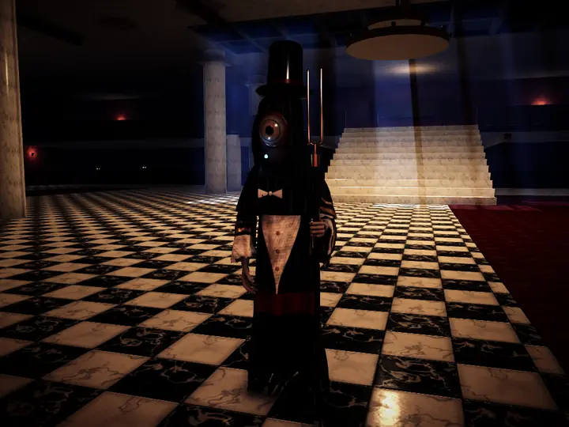

# The Direttore

The Direttore (the conductor) is the enemy of the theatre. It stands 2.4 m tall, in a top hat, a chalky tailcoat and with a tuning fork,
and it is the boss of the second branch, the buried theatre.

## What it is

- **Hit points.** 330, and a slow walk (`EnemyTemi.cs`).
- **Charge.** It telegraphs its charge for 1.2 s, then throws a fan of three darts; five when it is hurt.
- **Sound.** A theatre tone loops around it.

## Standard and desert

- **Standard.** On the theatre floors it replaces the abbot. As a boss it guards branch II, the [Teatro sepolto](../branches/teatro-sepolto.md),
  behind the Cancello del Teatro, which costs one Reliquia. Its resource is darkness crystals. In the Abyss the four bosses come in turn,
  one every three levels.
- **Desert.** It never walks the open world, and the desert's theatres spawn [Maschere](maschera.md) instead. It is one of the four bosses
  the stacks draw by place: see [the lord of the place](signore-del-luogo.md).

## Related

- [The Teatro sepolto](../branches/teatro-sepolto.md): the second branch.
- [The Maschera](maschera.md): the theatre's usher, a walker of both modes.
- [The abbot](abbot.md): the enemy it replaces on the theatre floors.
- [The lord of the place](signore-del-luogo.md): the desert bosses.
