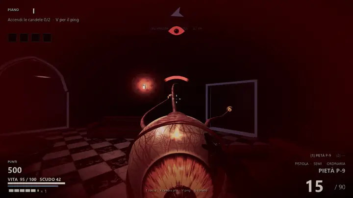

# The flying eye

The flying eye (`Occhio` in the code) is a floating eye that hovers over the floor instead of walking on it. It is the lightest enemy
of the family, with 80 hit points, and it is quicker than a monk.

## What it is

- **Hit points.** 80.
- **Movement.** It flies: it has no navigation agent, so it keeps its own height over the floor (`Enemy.cs`).
- **Pace.** The spawn code gives it 2.5 to 3.3 against 1.3 to 1.6 for a monk.
- **Sound.** A low eye hum loops while it is near.
- **Drops.** Rare blood: the cathedral doc counts flying things among the sources of blood.

## Standard and desert

- **Standard.** Eyes patrol the rooms with the monks and abbots, and they investigate noises as the monks do.
- **Desert.** Eyes join the walkers from about 300 m from the cathedral (danger 1.2). A flying enemy is replaced by a monk while it is
  day (`DesertDirector`), so the eyes fly only at night. At night their share follows the same mix as the other walkers.

## Related

- [The monk](monk.md): the walker that takes the eye's place by day.
- [The abbot](abbot.md): the heavier walker of the same mix.
- [The desert](../modes/desert.md): the open world, day and night.
- [The day and night cycle](../cycles/day-night.md): when the eyes fly.
