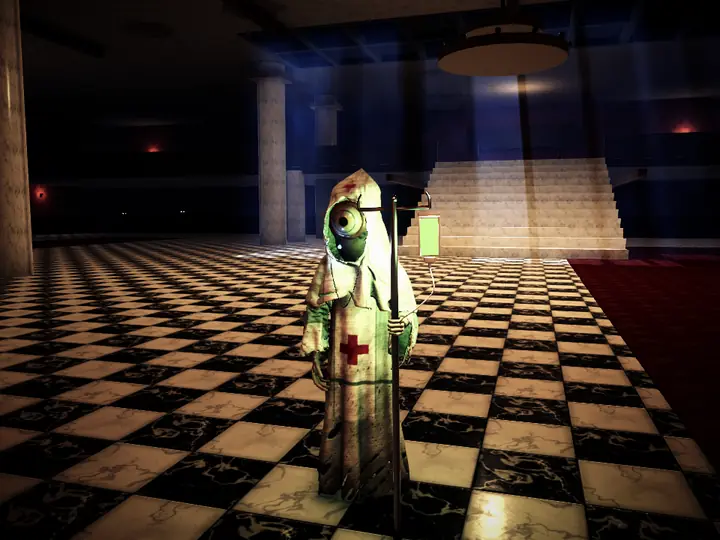

# The Infermiere

The Infermiere (the nurse) is the enemy of the sanatorium: a stained gown with a red cross, and a drip stand whose bag glows green.
The Primario calls two of them.

## What it is

- **Hit points.** 190, and a brisk walk (`EnemyTemi.cs`).
- **Needle.** Its needle puts your legs to sleep: a sedative that slows you to 55% of your speed for 2.8 seconds.
- **Sound.** A monitor's hum loops around it.
- **Drops.** Blood as the rare resource, as the nurses give it (cathedral doc).

## Standard and desert

- **Standard.** On the sanatorium floors it replaces the monk. The [Primario](primario.md) calls two of them, once every 45 seconds.
- **Desert.** In a desert sanatorium, and in a tower given the sanatorium theme (half of the towers that are not churches), 45% of the walkers are Infermiere; the rest are the usual mix. See [the desert](../modes/desert.md).

## Related

- [The sanatorium](../places/sanatorium.md): the place it stands in, in the desert.
- [The Primario](primario.md): the sanatorium's boss, and the nurses' caller.
- [The monk](monk.md): the walker it replaces on the standard floors.
- [The Sanatorio](../branches/sanatorio.md): the third branch.
