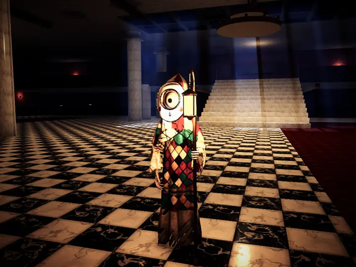

# The Maschera

The Maschera (the mask) is the usher of the theatre: a faded harlequin in a porcelain mask that leaves only one eye uncovered, with a lantern.
It is quick, but it fights only at arm's length.

## What it is

- **Hit points.** 150, and a fast run (`EnemyTemi.cs`).
- **Melee only.** It has no ranged attack.
- **Whistle.** At the first sight of a player it blows a whistle, once every 14 seconds. Those not already hunting run to the spot.
- **Sound.** A music box loops around it.

## Standard and desert

- **Standard.** On the theatre floors of the catacombs, which is the branch of the Teatro sepolto, it replaces the monk.
- **Desert.** In a desert theatre 45% of the walkers are Maschere; the rest are the usual mix. See [the desert](../modes/desert.md).

## Related

- [The theatre](../places/theatre.md): the place it stands in, in the desert.
- [The Direttore](direttore.md): the theatre's boss, and the abbot it replaces.
- [The monk](monk.md): the walker it replaces on the standard floors.
- [The desert](../modes/desert.md): where the walkers rest and wake.
