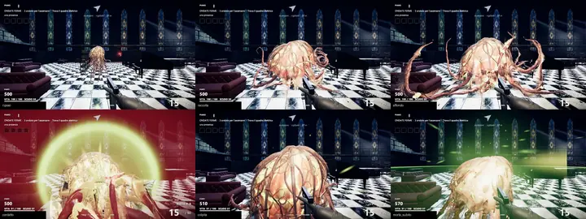

# The Medusa

The Medusa is a flying jellyfish: a translucent bell with a green light inside, a ring of long fangs and dozens of dripping tentacles.
It was rebuilt in November 2026 from a reference picture; its numbers and timings did not change.

## What it is

- **Hit points.** 140, and a speed of 1.9 (`AlienRig.cs`).
- **Melee.** 15 to 19 damage, with 2.6 seconds between attacks (medusa doc).
- **Weak point.** Its mouth.
- **Attack.** Before the blow its tentacles curl up, the bell flares and the organs blaze; then it lunges with a jet of mucus.
- **Blood.** Acid green mucus, the Medusa's colour in the blood effects.

## Standard and desert

- **Standard.** It flies over the floors from the second floor down, and it comes in the waves. It is one of the presences the stealth alert knows.
- **Desert.** None. The desert draws eight kinds of walker and four bosses, and the Medusa is not among them: see [the desert](../modes/desert.md).

## Related

- [The Veglia](veglia.md) and [the Portachiavi](portachiavi.md): the other presences of the standard floors.
- [The wave cycle](../cycles/wave-cycle.md): where the Medusa can come in a wave.
- [The catacombs](../zones/catacombs.md): where the floors are.
