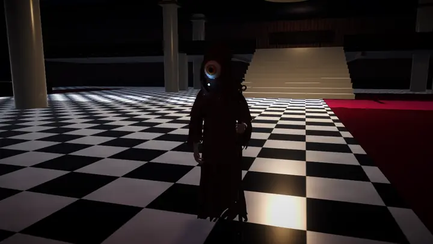

# The monk

The monk (*il monaco*) is the ordinary enemy of the game. Most of the others are built on its body, with the same rigged skeleton,
clips and navigation: the [abbot](abbot.md) is the monk made larger, and the desert's plague bearer, runner and statue are variants of it.

## What it is

- **Hit points.** 200, in both modes.
- **Staff.** The staff is a separate bone in the rig with its own body. When the monk dies it lets go, and the staff falls on its own.
- **Chant.** A monk chants a looping litany, which stops when it dies.
- **Death.** It finishes its fall, then sinks into the floor over 1.4 seconds, and a pool of blood grows under it.
- **Drops.** One or two bones or wood, with a 22% chance, and a rare resource with 2.5%. A kill with the knife doubles the chance of the common drop.

## Standard and desert

- **Standard.** The monk is a stealth enemy: it patrols the rooms, investigates noises and searches the last place where it saw you.
  On the theatre and sanatorium floors, outside the chapel, the [Maschera](maschera.md) and the [Infermiere](infermiere.md) take its place.
- **Desert.** There is no stealth. A walker born in the open rests in its zone until you come within 30 m (48 at night), until you hit it,
  or until one resting beside it, within 16 m, wakes. Up to about 300 m from the cathedral the walkers are monks alone, except in theatres
  and sanatoria; farther out the abbot, the flying eye, the flagellant, the plague bearer and the statue join the mix.

## Related

- [The abbot](abbot.md): the monk made larger, with its own drops.
- [The flying eye](flying-eye.md) and [the Appestato](appestato.md): other walkers of the desert.
- [The desert](../modes/desert.md): where the walkers rest and wake.
- [The catacombs](../zones/catacombs.md): where the standard monks patrol.
