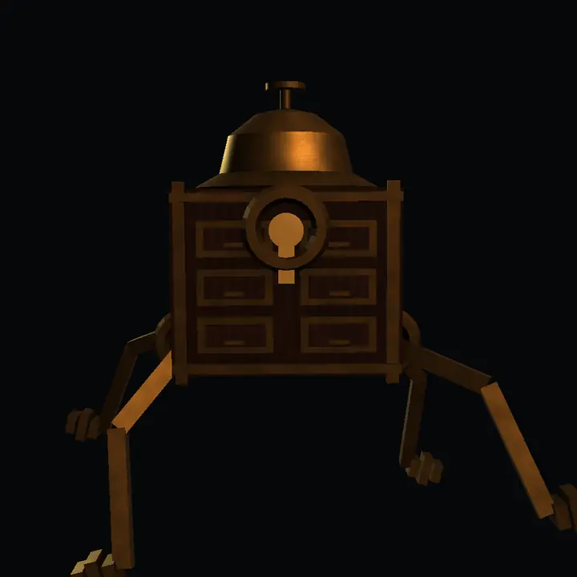

# The Portachiavi

The Portachiavi (the key-keeper) is the reception's key cabinet walking on its own: tarnished brass, four articulated keys, and a bell
that rings before it strikes. Its weak point is the glowing lock.

## What it is

- **Hit points.** 260 and a speed of 1.25, the figures the alien rig gives to the kinds it does not list (`AlienRig.cs`).
- **Weak point.** The glowing lock in its body, which is where its eye sits.
- **Warning.** Its bell sounds before the blow. Its keys rattle in a loop while it is near.
- **Drops.** Steel as the common resource (cathedral doc).

## Standard and desert

- **Standard.** It is one of the presences of the procedural floors of the catacombs, alongside the [Veglia](veglia.md) and the [Medusa](medusa.md).
- **Desert.** None. The open world's walkers are the ones listed in [the desert](../modes/desert.md).

## Related

- [The Veglia](veglia.md) and [the Medusa](medusa.md): the other alien presences of the standard floors.
- [The catacombs](../zones/catacombs.md): where it stands.
- [The Ossario](../branches/ossario.md): the first branch, whose floors draw it.
