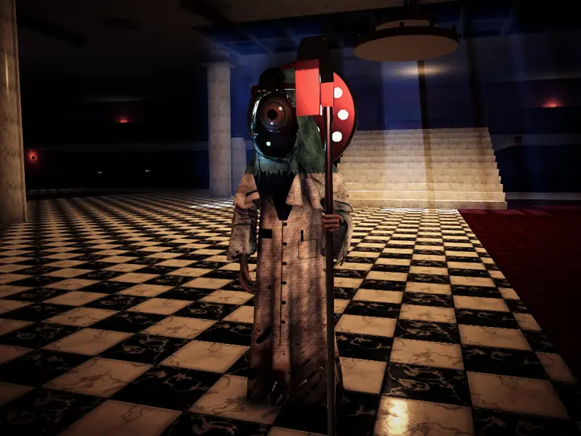

# The Primario

The Primario (the chief physician) is the enemy of the sanatorium. It is as large as an abbot: a bloodied gown, a skullcap, a surgical lamp
for a halo, a frontal mirror and a retractor. It is the boss of the third branch, the sanatorium.

## What it is

- **Hit points.** 360, and a slow walk (`EnemyTemi.cs`).
- **The call.** When it sees you, it calls two [nurses](infermiere.md), once every 45 seconds. They arrive from out of sight.
- **Drops.** Hearts as a rare resource, as abbots and chief physicians both give them (cathedral doc).

## Standard and desert

- **Standard.** On the sanatorium floors it replaces the abbot. As a boss it guards branch III, the [Sanatorio](../branches/sanatorio.md),
  behind the Cancello del Sanatorio, which costs one darkness crystal. Its resource is faith crystals.
- **Desert.** It is one of the four bosses the stacks draw by place: see [the lord of the place](signore-del-luogo.md). As a boss its hit points
  are the branch formula, which is much more than its 360. In the open, its call wakes the resting enemies within 16 m of it.

## Related

- [The Sanatorio](../branches/sanatorio.md): the third branch.
- [The Infermiere](infermiere.md): the nurses it calls.
- [The abbot](abbot.md): the enemy it replaces on the sanatorium floors.
- [The lord of the place](signore-del-luogo.md): the desert bosses.
