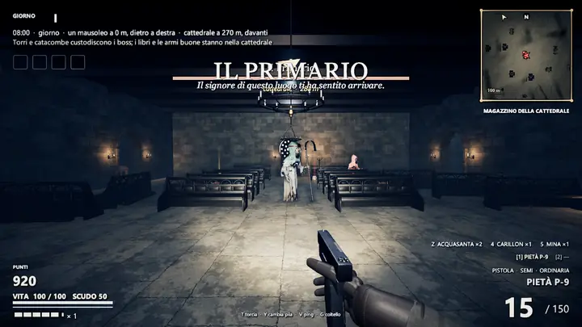
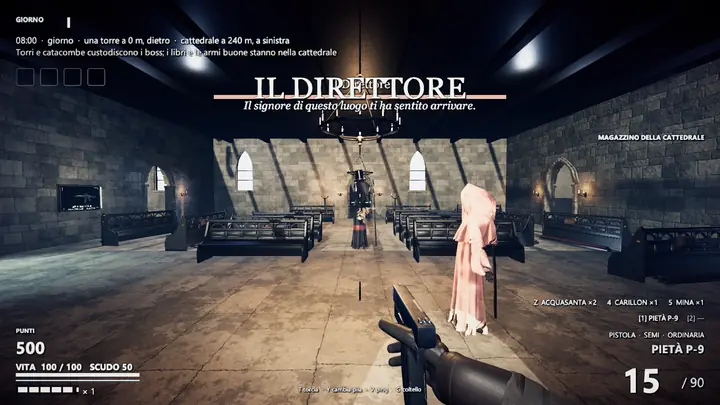
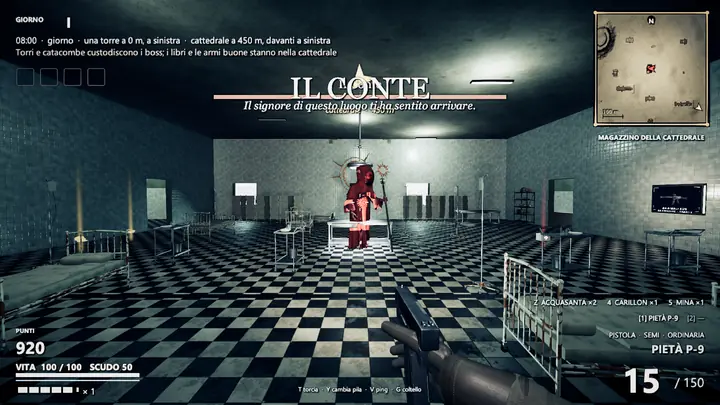

# The lord of the place

Every desert tower and catacomb has a boss in its boss hall, and the code calls it the lord of the place. It is never a new enemy: it is one
of the four branch bosses of the cathedral, the Cardinale, the Direttore, the Primario or the Conte, and the place decides which.

## What it is

- **Where.** The boss hall is on the top floor of a tower and at the bottom of a catacomb (see [the stacks](../stacks/tower.md)).
- **Which boss.** The branch is the place's number modulo four: 0 gives the Ossario's Cardinale, 1 the Teatro sepolto's Direttore, 2 the
  Sanatorio's Primario and 3 the Guardaroba's Conte.
- **Hit points.** (3,200 plus 700 for each step of danger above 1) times (1 plus 0.25 times the branch index). Danger is 1 at the cathedral
  and reaches 4 at 4.5 km (`DesertMode.Danger`).
- **Rest.** It rests in its hall until you come near, like the other guards, and it gives up and goes back to rest if you run more than
  220 m away for seven seconds.
- **Announcement.** It announces itself to the player nearest to it, with a banner and a roar.
- **Trophy.** The trophy of its branch goes to the store at once. In co-op the boss's fall is shared: every player's store receives it.
- **Map.** On the minimap a boss is a dark ring.

## Standard and desert

- **Standard.** The same four bosses fight in the cathedral's branches: see the [Cardinale](cardinale.md), the [Direttore](direttore.md),
  the [Primario](primario.md) and the [Conte](conte.md).
- **Desert.** The lord of the place is the only way the four bosses appear in the open world. None of them walks the sand as a walker: the
  walkers of the desert are monks, abbots, flying eyes (at night), flagellants, plague bearers, statues, and the themed Maschere and
  [Infermiere](infermiere.md) in theatres, sanatoria and sanatorium-themed towers.

## Related

- [The tower](../stacks/tower.md) and [the catacomb](../stacks/catacomb.md): the stacks where the lord waits.
- [The desert](../modes/desert.md): the open world.
- [The Cardinale](cardinale.md): the branch I boss, and the body of the Conte.
- [The Direttore](direttore.md) and [the Primario](primario.md): two of the four.
