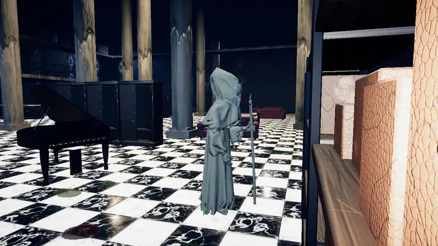

# The Statua

The Statua is a dark stone monk that freezes while someone looks at it and runs when no one does. It is the hardest walker to kill:
720 hit points, and bullets do 40% of their damage. The knife does 15%.

## What it is

- **Hit points.** 720 (`Enemy.Varianti.cs`).
- **Watch.** It moves only when no player is looking at it: no view axis of a player within 55 degrees, with a line of sight. The test is
  repeated every 0.08 s.
- **Run.** Unseen, it runs at 5.2 m/s with glowing eyes and a grinding loop of stone, and it strikes for 38 in melee.
- **Sound.** Stone does not chant: the statue grinds, and only while it moves (`Enemy.cs`).
- **Blood.** Dust rather than blood.

## Standard and desert

- **Standard.** The wave cycle draws it from the sixth wave, with 5% of the spawns and at most one alive at a time.
- **Desert.** It joins the walkers from about 1,950 m from the cathedral (danger 2.3), with a weight of 4: the last walker to join the mix.

## Related

- [The monk](monk.md): the body it is built on.
- [The wave cycle](../cycles/wave-cycle.md): where it is drawn.
- [The Appestato](appestato.md): the other variant of the desert's far mix.
- [The desert](../modes/desert.md): the open world where it stands.
