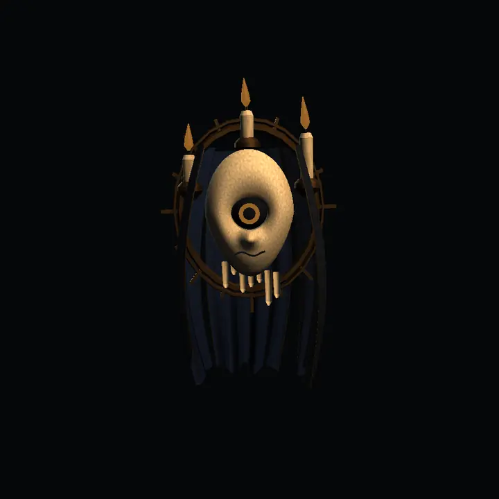

# The Veglia

The Veglia (the vigil) is a candle hung in a torn votive veil. It is fragile and fast, and its weak point is the two embers in its wax face.
It is the enemy of the processions of lights, when a whole group of them comes out at once.

## What it is

- **Hit points.** 60, and a speed of 3.5, the fastest figure in the alien rig (`AlienRig.cs`).
- **Weak point.** The two embers in its face.
- **Breath.** A breathing loop of its own, and a whisper when it dies (`Enemy.cs`).
- **Drops.** Bones and wood as the common resources, and embers as the rare one (cathedral doc).

## Standard and desert

- **Standard.** Veglie live on the procedural floors of the catacombs and in the wave cycle. Every fifth wave is the **Processione dei Lumi**:
  only Veglie spawn, 60% more than usual, up to four more alive at once. A [Reliquiario](../power-ups/reliquiario.md) always drops where the last one dies.
- **Desert.** None. The open world does not draw Veglie: its walkers are the ones listed in [the desert](../modes/desert.md).

## Related

- [The wave cycle](../cycles/wave-cycle.md): where the processions come from.
- [The Medusa](medusa.md): the other flying presence of the standard floors.
- [The Portachiavi](portachiavi.md): the other presence of the same floors.
- [The catacombs](../zones/catacombs.md): where the Veglie stand.
