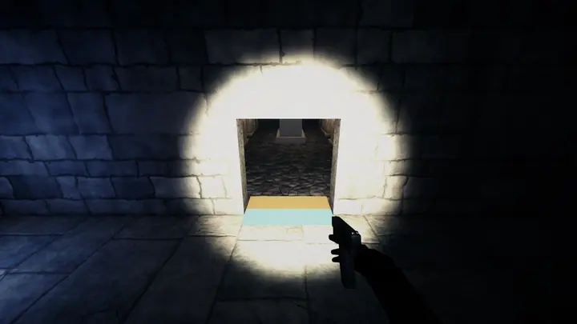

# Low passage

A low passage is a gap in a wall too low to walk through. You hold `C` or Ctrl to crouch and crawl through it.

## Where it leads

- **The secret room.** It is entered only through a low passage, and enemies do not reach it. See [the secret room](../rooms/secret-room.md).
- **Hidden walls.** Some walls of the floors hide a low passage, which you find by walking along them.
- **The secret wall.** In the arms and magic, a wall carved with an eye opens with `F` and then a crawl through a 1.3 metre tunnel. See
  [the arms and magic](../spells/fiamma-sacrilega.md).

## Standard and desert

Only the standard game has these passages. The desert page does not describe low passages; see [the desert](../modes/desert.md).

## Related

- [The secret room](../rooms/secret-room.md): the room behind the lowest passage.
- [Glass eyes](../collectibles/glass-eye.md): the hidden hunt that the carved eyes belong to.
- [The portcullis](portcullis.md): the iron gate of the catacomb landings.
