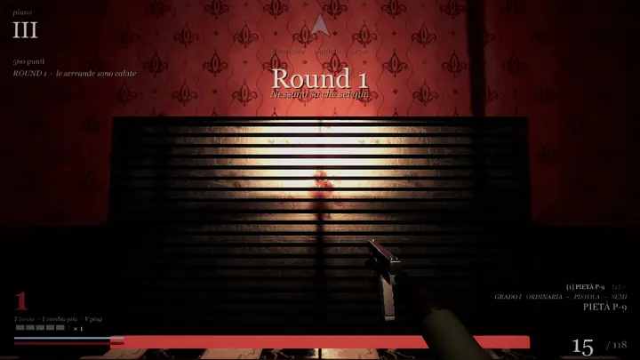

# Shutter (steel and round)

The shutter is the steel door of the Tower's floors. It has two uses, one for each cycle.

## In the wave cycle

- The arrival lift and the exit lift are closed by a steel shutter, except the start.
- The exit lift, in the boss area, opens when three waves are cleared. You can keep fighting and buying after that.

## In the candle cycle

- Lighting a candle drops steel shutters over every exit of its arena, and a round begins.
- When the round is over the shutters rise. Enemies outside hear the noise and press against them, but do not come in until they rise.

## Standard and desert

Only the standard game has shutters. The desert has no waves and no candle rounds; its gates are the stairs of its stacks. See
[the desert](../modes/desert.md).

## Related

- [The portcullis](portcullis.md): the iron gate of the catacomb landings.
- [The arena](../rooms/arena.md): the room the candle's shutters seal.
- [The wave cycle](../cycles/wave-cycle.md): the cycle that uses the lift shutter.
