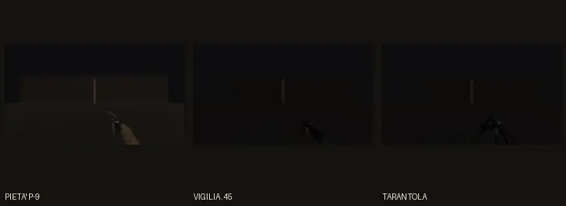

# Grade I (Ordinary)

Grade I is the first of the five power grades, shown in grey. It holds three weapons.

## The weapons

- [PIETA' P-9](../weapons/pieta-p9.md): the starting pistol.
- [VIGILIA .45](../weapons/vigilia-45.md): a heavier pistol.
- [TARANTOLA](../weapons/tarantola.md): a micro-SMG.

## Standard and desert

The grades are the same in both modes. Where they come from differs. In the standard game the walls of a floor offer them, and the
[Scrigno](../rooms/shop-room.md) can draw any grade. In the desert the sand gives a few grade I weapons for free, and the armoury
sells the rest at twice the price; see [the desert](../modes/desert.md).

## Related

- [Grade II](grade-2.md): the next grade, with ten weapons.
- [Weapons](../weapons/pieta-p9.md): the 28 models in the five grades.
- [The shop room](../rooms/shop-room.md): where the walls and the chest sell weapons.
