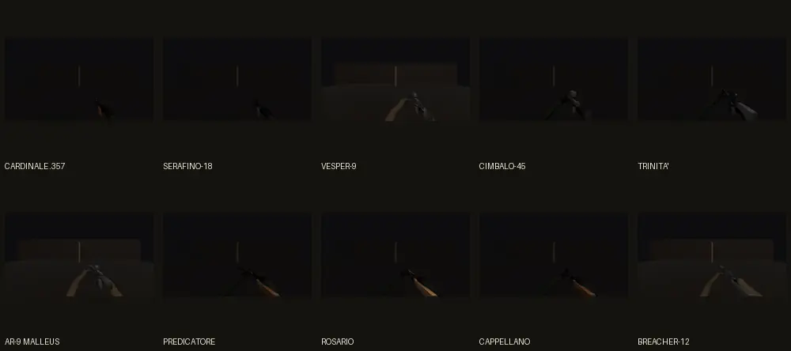

# Grade II (Choice)

Grade II is shown in green and holds ten weapons: the most numerous grade with grade III.

## The weapons

- [CARDINALE .357](../weapons/cardinale-357.md): a revolver that pierces.
- [SERAFINO-18](../weapons/serafino-18.md) and [VESPER-9](../weapons/vesper-9.md): machine pistol and SMG.
- [CIMBALO-45](../weapons/cimbalo-45.md): an SMG that hits for 29.
- [TRINITA'](../weapons/trinita.md): a burst rifle.
- [AR-9 MALLEUS](../weapons/ar9-malleus.md): an assault rifle.
- [PREDICATORE](../weapons/predicatore.md): a lever-action carbine.
- [ROSARIO](../weapons/rosario.md): a bolt-action rifle.
- [CAPPELLANO](../weapons/cappellano.md) and [BREACHER-12](../weapons/breacher-12.md): a double-barrel and a pump shotgun.

## Where it comes from

The sacristy's rack, in the cathedral, gives three weapons of grade 2 to take down for free; with the [forge](../works/la-forgia.md) built,
one of them is of grade 3. The catacomb walls and the Scrigno can draw grade 2 too.

## Standard and desert

The same grade in both modes. The desert gives grade II weapons for free only in a boss hall; the armoury sells the others at twice the
standard price. See [the desert](../modes/desert.md).

## Related

- [Grade I](grade-1.md) and [Grade III](grade-3.md): the grades on either side.
- [La Sacrestia](../works/la-sacrestia.md): the rack of free weapons.
- [The Scrigno](../rooms/shop-room.md): the mystery chest that draws any grade.
