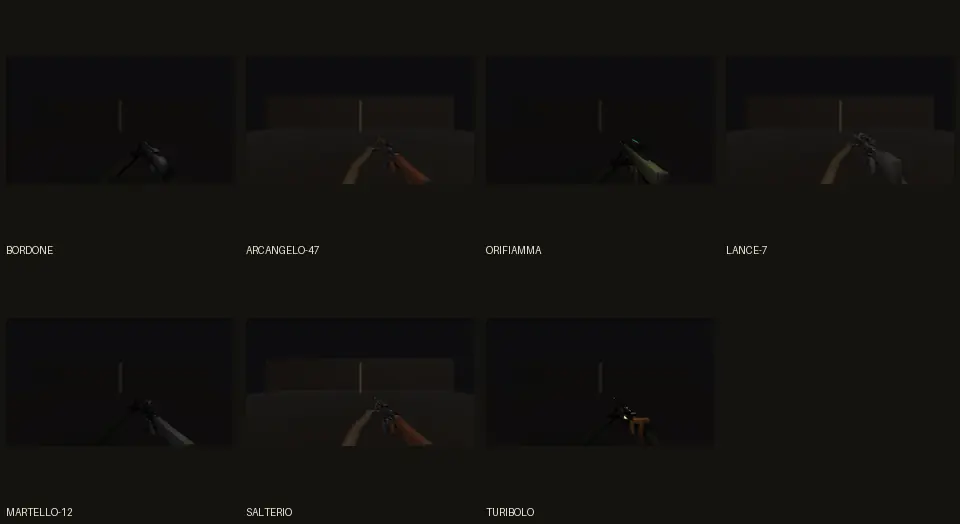

# Grade III (Rare)

Grade III is shown in blue and holds seven weapons, among them the first of the special weapons.

## The weapons

- [BORDONE](../weapons/bordone.md) and [ORIFIAMMA](../weapons/orifiamma.md): two bullpup rifles.
- [ARCANGELO-47](../weapons/arcangelo-47.md): an assault rifle.
- [LANCE-7](../weapons/lance-7.md): a precision rifle with a 4x scope.
- [MARTELLO-12](../weapons/martello-12.md): a semi-automatic shotgun.
- [SALTERIO](../weapons/salterio.md): a drum machine gun.
- [TURIBOLO](../weapons/turibolo.md): the sacred flamethrower, a special weapon.

## Where it comes from

With the [forge](../works/la-forgia.md) built, one of the three weapons of the sacristy's rack is of this grade. The Scrigno draws it more
often the deeper you are.

## Standard and desert

The same grade in both modes. The desert's sand does not give grade III weapons for free; the armoury sells them at twice the
standard price. See [the desert](../modes/desert.md).

## Related

- [Grade II](grade-2.md) and [Grade IV](grade-4.md): the grades on either side.
- [La Forgia](../works/la-forgia.md): the work that raises one of the rack's weapons to this grade.
- [The Scrigno](../rooms/shop-room.md): the chest that draws it.
