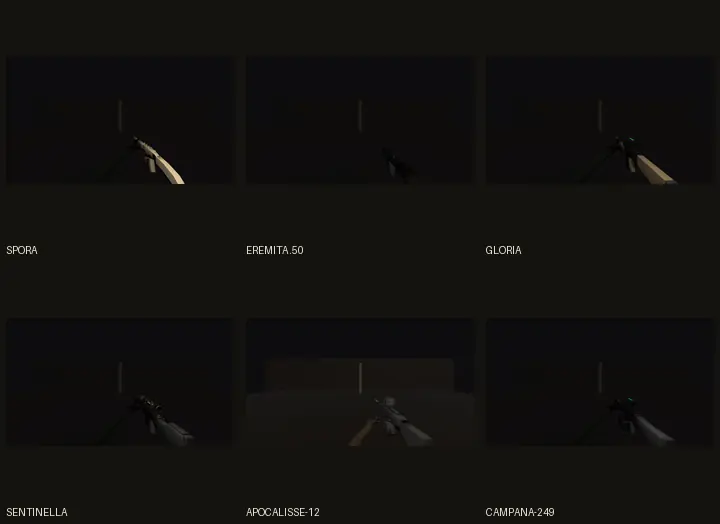

# Grade IV (Epic)

Grade IV is shown in purple and holds six weapons, one of them an alien launcher.

## The weapons

- [EREMITA .50](../weapons/eremita-50.md): a magnum pistol that pierces two enemies.
- [GLORIA](../weapons/gloria.md): a battle rifle with a 4x ACOG.
- [SENTINELLA](../weapons/sentinella.md): a sniper rifle that pierces three.
- [APOCALISSE-12](../weapons/apocalisse-12.md): an automatic drum shotgun.
- [CAMPANA-249](../weapons/campana-249.md): a light machine gun with a belt of 100.
- [SPORA](../weapons/spora.md): an alien spine launcher, a special weapon.

## Where it comes from

The walls of the catacombs and the Scrigno can draw it; the Scrigno draws the higher grades more often the deeper you are. The sand does
not give grade IV weapons for free.

## Standard and desert

The same grade in both modes. In the desert the armoury sells these weapons at twice the standard price; see [the desert](../modes/desert.md).

## Related

- [Grade III](grade-3.md) and [Grade V](grade-5.md): the grades on either side.
- [The Scrigno](../rooms/shop-room.md): the chest that draws it.
- [Weapons](../weapons/pieta-p9.md): the 28 models.
