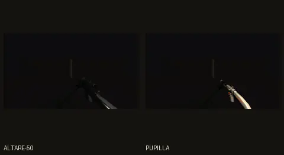

# Grade V (Relic)

Grade V, the Relic grade, is shown in gold. It holds only two weapons.

## The weapons

- [ALTARE-50](../weapons/altare-50.md): an anti-materiel rifle, 420 damage, piercing five enemies.
- [PUPILLA](../weapons/pupilla.md): an eye-rifle with a continuous amber beam that pierces everything.

## Where it comes from

Grade V is the top of the Scrigno's draw, which weighs the higher grades more the deeper you are. The sand does not give it for free.

## Standard and desert

The same grade in both modes. In the desert the armoury is the only place that sells these two weapons, at twice the standard price;
see [the desert](../modes/desert.md).

## Related

- [Grade IV](grade-4.md): the grade below.
- [The Scrigno](../rooms/shop-room.md): the mystery chest that draws it.
- [The Cardinale](../enemies/cardinale.md): the first branch's boss, the only source of relics.
