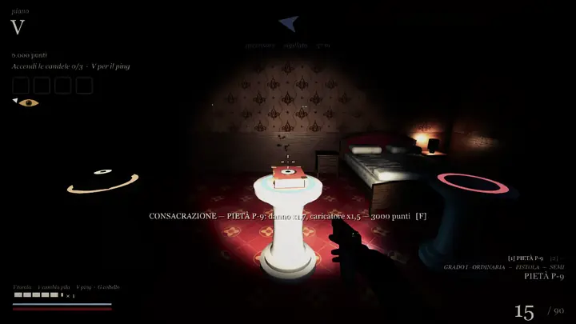

# The Book of the Arsenal

The Book of the Arsenal is the book of the weapons. Its outer nodes work on every weapon you hold, and its inner nodes are the seals that
you trace on the weapon with the left hand. It has the same 19-node shape as the [Book of Witchcraft](witchcraft.md).

## How it is bought

- **Outer nodes.** They can always be bought. Each costs 1,250 points, plus 250 for each outer node you already own in this book.
- **Inner nodes.** Each needs one of its two neighbouring outer nodes. It costs 3,000 points, plus 500 for each inner node you own.
- **Supreme.** It needs four inner nodes, and it costs 9,000 points.
- **Keeping.** Purchases last the whole run. Dying empties the essence and turns off the seals on the weapons.

## The outer nodes

| Node | Effect |
| --- | --- |
| Mira del Corvo | spread -30% |
| Colpo di Grazia | +40% damage to enemies under a third of their health |
| Perforazione | bullets pierce one more enemy |
| Forza d'Impatto | +15% damage |
| Raffica Mortale | fire rate +12% |
| Detonazione | one shot in sixteen explodes (2.5 m) |
| Munizioni Fantasma | one shot in eight does not use a round |
| Caricatore Esteso | magazines +25% |
| Maneggevolezza | aim and reload 20% faster |
| Ricarica Arcana | the holstered weapon reloads itself after 3 s |
| Stabilità Oscura | recoil -30% |
| Clessidra di Piombo | each kill adds 1.5 s to the seal on the weapon, up to 60 s |

## The seals

The six inner nodes are the seals: [Danni Critici](../seals/danni-critici.md), Sanguinamento, Incendiario, Corrosivo, Elettrificato and Gelido.
Each seal lasts 45 seconds for 40 essence. The supreme node is Arma Maledetta.

## Standard and desert

- **Standard.** Every catacomb floor has its secret book room, which holds this book or the Book of Witchcraft.
- **Desert.** The desert doc describes no secret book room and no grimoire; see [the Book of Witchcraft](witchcraft.md).

## Related

- [The Book of Witchcraft](witchcraft.md): the book of the spells.
- [Essence](../pickups/essence.md): what a seal costs.
- [Danni Critici](../seals/danni-critici.md): the first seal.
- [Weapon grades](../grades/grade-1.md): the weapons the book works on.
