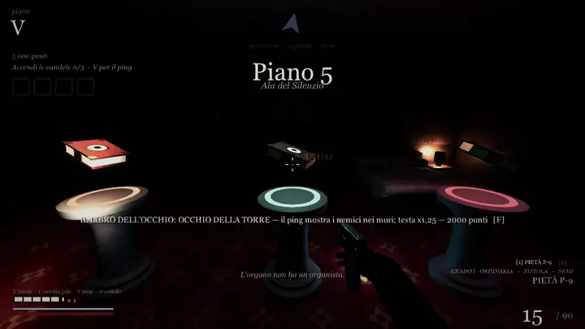

# The Book of Witchcraft

The Book of Witchcraft is the book of the left hand: the spells. Each floor hides a secret book room with it or with the Book of the
Arsenal, and you buy nodes of the book with points. It is a dodecahedron of 19 nodes: twelve outer nodes on a ring, six inner nodes on a
hexagon, and the supreme node in the centre.

## How it is bought

- **Outer nodes.** They can always be bought. Each costs 1,250 points, plus 250 for each outer node you already own in this book.
- **Inner nodes.** Each needs one of its two neighbouring outer nodes. It costs 3,000 points, plus 500 for each inner node you own.
- **Supreme.** It needs four inner nodes, and it costs 9,000 points.
- **Keeping.** Purchases last the whole run. Dying empties the essence and turns off the seals, but it does not take nodes.

## The outer nodes

| Node | Effect |
| --- | --- |
| Lingua di Serpe | spells deal 25% more damage |
| Occhio del Corvo | spell range and radius +35% |
| Clessidra Rotta | spell cooldowns -30% |
| Gesto Rapido | gestures 25% faster |
| Luna Calante | enemies hit by a spell slowed 30% for 2 s |
| Radici Cave | essence comes back twice as fast when still or crouched |
| Patto di Sangue | missing essence is paid with health, never below 20 |
| Mietitura | +5 essence per kill |
| Eco del Rito | one spell in five is free |
| Pelle di Runa | 35% less damage taken for 2.5 s after a spell |
| Pozzo Profondo | maximum essence +40 |
| Sorgente Nera | essence comes back 60% faster |

## The spells

The six inner nodes are the spells: [Fiamma Sacrilega](../spells/fiamma-sacrilega.md), [Catena del Fulmine](../spells/catena-del-fulmine.md), [Morsa di Gelo](../spells/morsa-di-gelo.md), [Sigillo di Sangue](../spells/sigillo-di-sangue.md),
[Passo d'Ombra](../spells/passo-d-ombra.md) and [Onda del Dodecaedro](../spells/onda-del-dodecaedro.md), with the supreme node [Essenza Maledetta](../spells/essenza-maledetta.md) at the centre.

## Standard and desert

- **Standard.** Every catacomb floor has its secret book room, which holds this book or the Book of the Arsenal.
- **Desert.** The desert doc describes no secret book room and no grimoire. Its cathedral has the Library of Vows for perk books instead.

## Related

- [The Book of the Arsenal](arsenal.md): the other book, for the weapons.
- [Essence](../pickups/essence.md): the left hand's resource, paid by every spell.
- [Fiamma Sacrilega](../spells/fiamma-sacrilega.md): the first spell.
- [Perks](../systems/perks.md): the other magic books, the perk books of the library.
